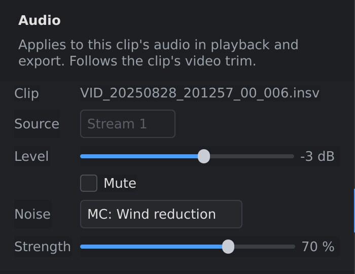
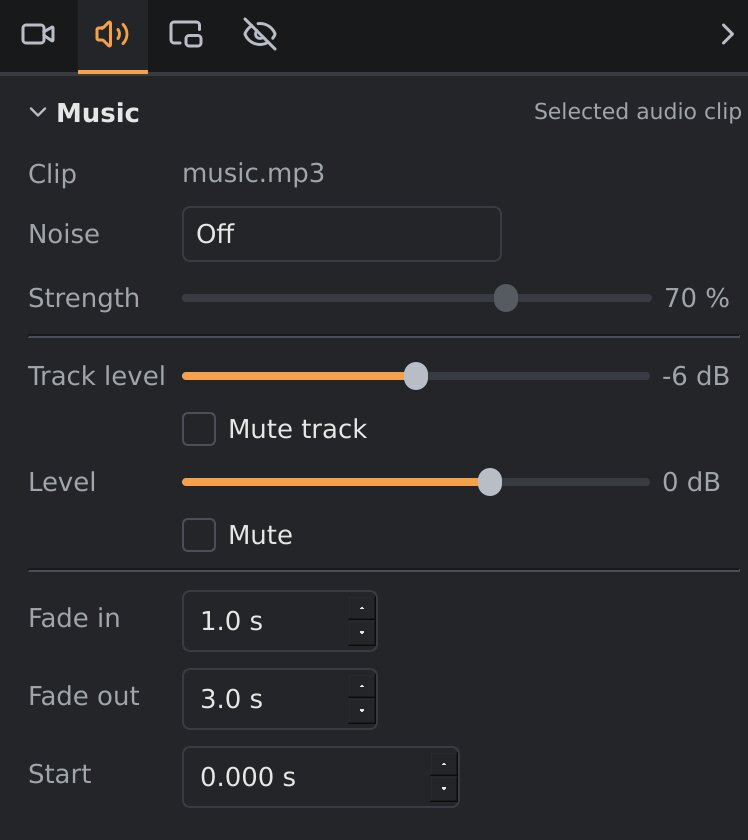

# Audio and noise reduction

This page covers the sound of your video: the camera's own microphones,
music and other audio files, volume and fades, and taking out wind and other
noise. How to add, move, trim and split audio clips on the timeline is in
[The timeline](timeline.md).

## Where the sound comes from

- **The camera's sound.** Each `.insv` clip on the video track plays the
  sound the X5 recorded.
- **An external microphone.** If a microphone such as the Insta360 Mic Air
  was connected to the camera, the clip holds two sound recordings
  (*streams*): the camera's own microphones, and the external one.
- **Audio files** on audio tracks: music, or sound from a separate recorder.
- **An overlay's sound.** Overlay videos are silent until you put their
  sound on an audio track (right-click the overlay clip: **Put its sound on
  an audio track**).

Everything plays together, in playback and in the export.

## The Audio panel

The **Audio** panel shows the settings of one clip. Which clip that is
depends on what's selected:

- **A video clip** (`.insv`): the clip you selected on the video track, or
  the clip under the playhead if none is selected.
- **An audio clip**: click it on an audio track to select it. Press `Esc`,
  or click a clip on the video track, to go back to the video clip.

 

*Left: a video clip. Right: a music clip on an audio track.*

### For a video clip

| Setting | What it does |
|---|---|
| **Clip** | The clip's file name. |
| **Source** | Which of the clip's sound recordings it plays: **Stream 1** or **Stream 2**. Only clips with an external microphone have two. |
| **Level** | The clip's volume, from −24 dB to +12 dB. 0 dB leaves it as recorded; negative values make it quieter, positive values louder. |
| **Mute** | Silences this clip. |
| **Noise** and **Strength** | Noise reduction, see below. |

The **M** box in the **Video** track header on the timeline mutes the sound
of all video clips at once.

### For an audio clip

| Setting | What it does |
|---|---|
| **Track** | The name of the track the clip is on. |
| **Track level** and **Mute track** | The volume of the whole track, on top of each clip's own level, and muting it. |
| **Clip** | The clip's file name. |
| **Level** and **Mute** | This clip's own volume, and muting it. |
| **Noise** and **Strength** | Noise reduction, see below. |
| **Fade in** / **Fade out** | Fades the clip in from silence at its start, or out to silence at its end, over this many seconds. The fades show as slanted lines over the clip's waveform. |
| **Start** | Where the clip starts on the timeline, in seconds. The arrows move it by 10 milliseconds, for lining up a separate recorder with the picture (see below). Greyed out for a linked clip, which moves with its video. |

The waveform drawn on each clip shows how loud it is, with its level and
fades applied, so you can see the effect of your changes.

## Two microphones

The `.insv` file doesn't say which stream is the camera's microphones and
which the external microphone. Pick each one under **Source** and listen.

To use both, for example your voice from the Mic Air and the engine from the
camera, right-click the clip on the video track and choose **Put the other
mic on an audio track**. The second stream goes onto an audio track called
*Mics*, linked to the clip, and the two can now have their own level, mute
and noise reduction. Its stream is then greyed out under **Source**, so it
isn't played twice.

## Noise reduction

Each clip, on the video track or on an audio track, can have one kind of
noise reduction. Pick it under **Noise**, and set how strongly it works with
**Strength**. Picking a mode sets its usual strength.

| Mode | What it does | Use it for | Default strength |
|---|---|---|---|
| **Off** | No noise reduction. | | |
| **Wind reduction** | Turns down wind noise, and keeps voices and other sounds that stand out above it. | Walking, cycling, talking outdoors: wind without an engine. | 70 % |
| **MC: Wind reduction** | For motorcycles. Follows the engine's pitch and keeps its sound, and turns down the rumble around it, wind most of all. Road noise stays. | Riding, with the engine as part of the sound. Works best on a microphone that's sheltered from the wind: it can't dig an engine out of a microphone the wind drowns. | 70 % |
| **Hiss / hum** | Turns down steady background noise (hiss, fans, air conditioning) and mains hum, and keeps voices and anything else that comes and goes. | Quiet scenes, indoors. Not for riding: a steady engine counts as background noise too. | 50 % |
| **Voice only** | Keeps speech and removes everything else: engine, wind, road, music. | Talking to the camera while riding, when only your voice matters. | 100 % |
| **Voice + ambience** | Keeps speech and turns everything else down evenly, so the scene can still be heard. | Talking to the camera, keeping some sound of the ride. | 50 % |

Noise reduction applies to playback and the export. Listen with it on and
off to choose; more strength takes out more noise, but too much can make
what's left sound thin or watery.

**The voice modes** look 3.5 seconds ahead in the sound, so jumping to
another part of the video takes a moment longer while one of them is on.
They need ONNX Runtime (`libonnxruntime1.21` on Debian 13, `libonnxruntime1.23` on Testing and Ubuntu 26.04)
and a speech model that comes with orbis-reframe. If either is missing,
choosing a voice mode says so, and the clip keeps its previous setting.

## Lining up a separate recorder

Sound from a separate recorder (a phone, a voice recorder) doesn't start at
the same moment as the camera, so it has to be lined up by hand:

1. Add the recording to an audio track (**Media ▸ Add audio file…**) and drag
   it roughly into place.
2. Find a sharp sound that both recorded: a clap, a door, a word.
3. Zoom in on the timeline (`Ctrl+` mouse wheel) until you can see that
   sound in both waveforms, and drag the clip until they line up.
4. Select the clip, and fine-tune with the arrows of **Start** in the
   **Audio** panel (10 milliseconds per click) while you listen.

Clapping once in front of the camera at the start of each recording makes
this much easier.
