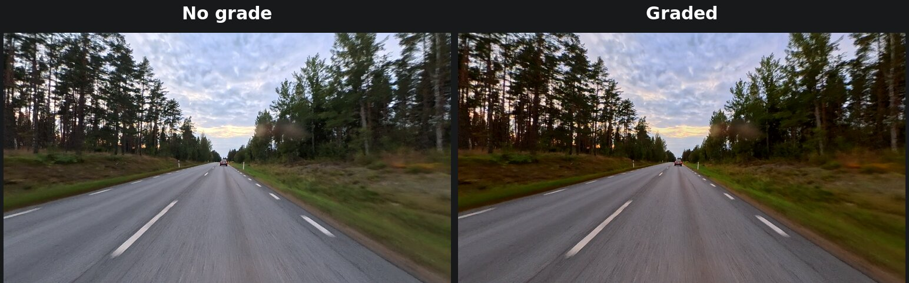
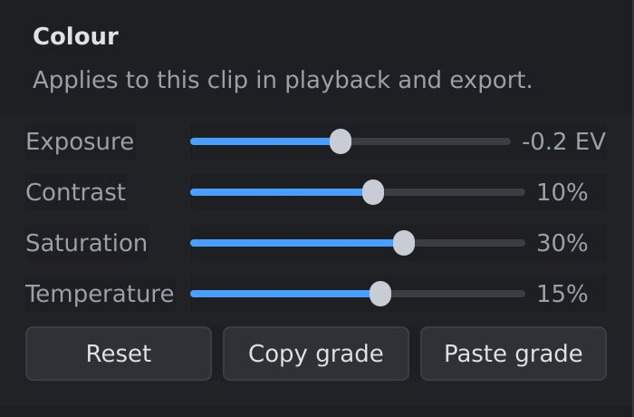

# Colour

The **Colour** section (settings sidebar, **Video** tab) corrects the brightness and colours of a clip: to
brighten a dark clip, make colours richer, or make clips filmed at different
times of day match.

*Right: exposure −0.2 EV, contrast +10 %, saturation +30 %, temperature
+15 %. Warmer and richer colours, with the bright sky kept.*

## The settings

| Setting | What it does | Range |
|---|---|---|
| **Exposure** | Makes the whole picture brighter or darker, in stops (EV): +1 EV is twice as bright, −1 EV half as bright. | −3 to +3 EV |
| **Contrast** | Positive values make dark parts darker and bright parts brighter; negative values make the picture flatter. | −100 % to +100 % |
| **Saturation** | Positive values make colours stronger; negative values make them paler. −100 % gives black and white. | −100 % to +100 % |
| **Temperature** | Positive values make the picture warmer (more yellow-orange), negative values cooler (more blue). | −100 % to +100 % |

All four at 0 leave the picture as filmed. Changes show in the viewport at
once. **Reset** sets all four back to 0.

## Which clip it changes

The colour settings belong to one clip on the video track: the clip you
selected, or the clip under the playhead if none is selected (see
[The main window](main-window.md)). Each clip keeps its own settings. When
you split a clip, both halves keep them.

The settings are the same for the whole clip: they don't change over time.
They apply to playback, screenshots and the export. Overlay videos aren't
changed.

## Giving several clips the same look

1. Select the clip whose look you want, and click **Copy grade**.
2. Select another clip, and click **Paste grade**. It gets all four
   settings.

The same is on the timeline: right-click a clip for **Copy colour grade**,
**Paste colour grade**, and **Paste colour grade to all clips**, which gives
every clip on the video track the copied look.

The copied grade is kept until you close orbis-reframe, so you can paste it
as often as you like. **Edit ▸ Undo** (`Ctrl+Z`) takes back a paste or a
Reset; pasting to all clips is undone in one step.

## Tips

- **Watch the sky.** 360° footage nearly always has bright sky in it. Raising
  the exposure or the contrast can turn it plain white, and the detail can't
  be brought back. Look at a frame with a lot of sky while you set them.
- **Small steps.** Small changes (a few tenths of a stop, 10 to 30 %) usually
  look natural. To compare with the original, click **Reset**, then
  **Edit ▸ Undo** (`Ctrl+Z`) to get your settings back.
- **Make clips match.** If one clip is darker or bluer than the one before
  it, put the playhead on the cut, and adjust the second clip until the two
  sides of the cut look alike.
