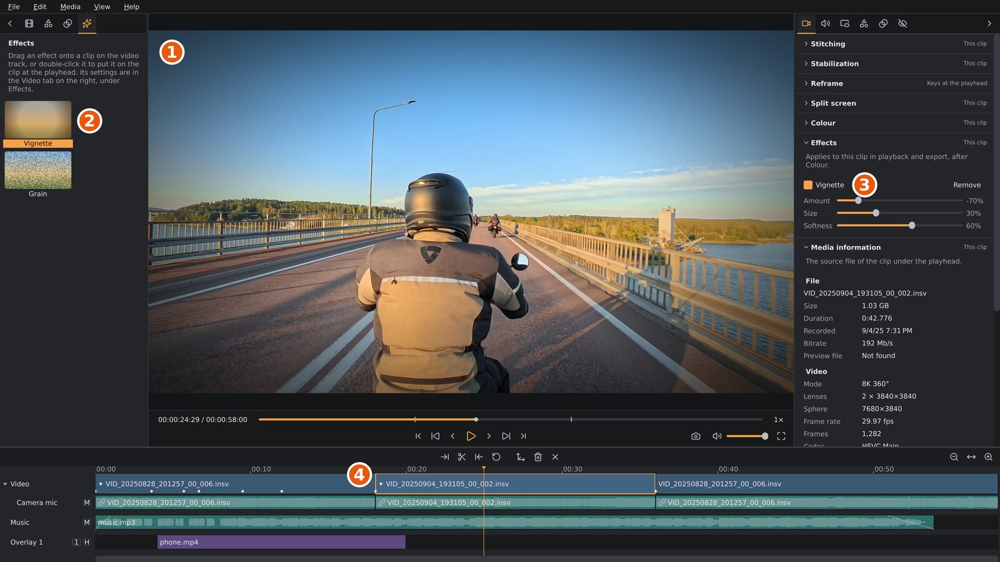
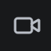

# Effects

Effects change the look of a clip's picture after its colour. For now
there are two: the **Vignette**, which makes the picture darker (or lighter)
toward its edges and draws the eye to the middle, and **Grain**, the
look of film. More are planned.

1. A clip with a vignette: the corners darker.
2. The media sidebar's **Effects** tab, with the effects to put on a clip.
3. The **Effects** section in the settings sidebar's **Video** tab: the
   clip's effects and their settings.
4. A ✦ before a clip's name on the timeline: it has an effect on.

## Putting an effect on a clip

Open the media sidebar's **Effects** tab
(), then:

- drag an effect (**Vignette**, **Grain**) onto a clip on the video track:
  the clip it would go on is outlined; or
- double-click it (or select it and press `Enter`, or right-click it and
  choose **Add to the clip at the playhead**) to put it on the selected
  clip, or else the clip under the playhead.

The clip is then selected and the settings sidebar shows its **Effects**
section, in the **Video** tab
(), under
**Colour**. A clip has each effect once: putting one on a clip that has it
already leaves it as it is.

Effects work on 360° clips and on flat videos on the video track, not on
picture-in-picture clips or titles.

## Changing and removing an effect

The **Effects** section shows the effects of the selected clip, or else of
the clip under the playhead. Each effect has a heading with its name, and
its settings under it:

- The tick box by the name turns the effect off without losing its
  settings, to compare the clip with and without it.
- **Remove** takes the effect off the clip.

**Edit ▸ Undo** (`Ctrl+Z`) undoes any of these, like any other edit.

### Vignette

| Setting | What it does | Range |
|---|---|---|
| **Amount** | How much darker the edges get: −100 % turns them black. Above 0 they get lighter instead, 100 % white. | −100 % to 100 % (new: −30 %) |
| **Size** | Where it starts: at 0 % right from the middle of the picture, at 100 % only in the corners. | 0 % to 100 % (new: 50 %) |
| **Softness** | How gradually it comes in: at 0 % a hard edge, at 100 % so gradual that even the corners aren't at the full Amount. | 0 % to 100 % (new: 50 %) |

The vignette follows the shape of the video, an oval that reaches the
corners. It belongs to the whole video picture:

- In a [split screen](reframing.md#split-screen), the corners of the
  video get darker, not the corners of each pane. The divider between the
  panes stays its own colour.
- A flat video with bars at its sides gets darker toward the corners of
  the video too; the bars stay black.

### Grain

| Setting | What it does | Range |
|---|---|---|
| **Amount** | How strong the grain is. It is strongest in the midtones: black and white stay clean. | 0 % to 100 % (new: 25 %) |
| **Size** | How big a grain is: at 100 % one pixel of a 1080p video. | 50 % to 300 % (new: 100 %) |
| **Colour** | At 0 % the grain is grey, the same in red, green and blue. Toward 100 % each colour gets its own grain. | 0 % to 100 % (new: 0 %) |

The grain is new on every frame, so it moves when the video plays. A
paused frame keeps its grain. Its size goes with the video's size, not
its pixels: a 4K export has the same grain as a 1080p one, just in more
detail. When a clip runs slower than its own frame rate (slow motion, or a
25 fps clip in a 50 fps project), a frame shown twice keeps its grain.

The viewport draws the grain at its own size, one grain value per screen
pixel at most. When the viewport is smaller than the export, the grain
there looks coarser than in the export, at the export's strength.

Colour grain is softer in an exported video than in the viewport: the
video stores colour at half the resolution of brightness. Grey grain keeps
its full detail.

## Effects and other edits

- Effects come after the [colour](colour.md): the vignette darkens the
  graded picture, then the grain goes on top.
- The halves of a split clip and a duplicated clip keep its effects.
- A transition blends the two clips with their effects.
- [Track subject](reframing.md#track-subject) and the number-plate scan
  ([Privacy blur](privacy.md)) look at the picture without effects.

A project with an effect on a clip can't be opened by orbis-reframe
versions before effects.
