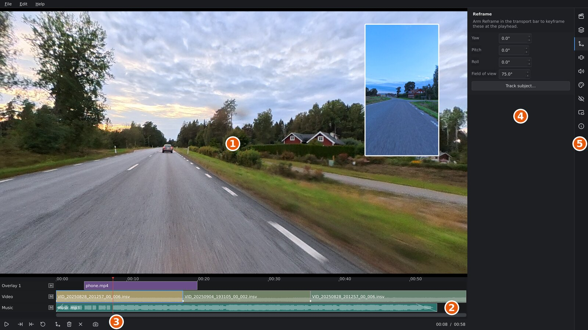
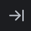
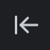
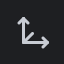
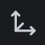
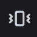
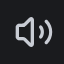

# The main window

This page is a tour of orbis-reframe's window: what each part is called,
what it's for, and which chapter covers it in detail. The later chapters use
the names from here.

Without a project open, the window shows the **project library**, your
projects as cards; see [Projects and export](projects-and-export.md#the-project-library).
With one open, it looks like this:

1. The **viewport**: the picture.
2. The **timeline**: your clips, overlays and audio, in time order.
3. The **transport bar**: play, trim and keyframe buttons.
4. The **settings panel** that's open, here **Reframe**.
5. The **rail**, the icons that pick the settings panel.

The title bar shows the project's file name, or *untitled* for a project
that hasn't been saved yet. A `*` after the name means there are unsaved
changes.

## The viewport

The viewport shows the video as your export will look: a flat picture cut
out of the 360° sphere. Its shape follows the project's aspect ratio
(16:9, 9:16, 1:1 or 4:3, set in the **Project** panel), so what you frame
here is what you get.

| To | Do |
|---|---|
| Look around | Drag with the left mouse button. |
| Zoom in or out (narrower or wider view) | Turn the mouse wheel. |
| Move an overlay (picture-in-picture) | Drag it. The pointer changes to a four-way arrow over one. |
| Remove a privacy blur | Right-click it. See [Privacy blur](privacy.md). |

Looking around only changes what you see right now. To make the export
follow a view, you set **reframe keyframes**, covered in
[Reframing](reframing.md).

## The timeline

Under the viewport is the timeline: your edit, from left to right in time.
From top to bottom it has:

- the **ruler**, with the time. Click or drag on it to move the **playhead**,
  the vertical line that marks the frame shown in the viewport;
- any **overlay tracks**: videos shown as picture-in-picture over the 360°
  video;
- the **video track**: your `.insv` clips, one after another, with a hard
  cut between each pair;
- any **audio tracks**: music, sound from an external recorder, or a second
  microphone.

Clicking a clip selects it. It doesn't move the playhead: only the ruler
does that. [The timeline](timeline.md) explains how to arrange, trim, split and
speed up clips.

## The transport bar

The strip at the bottom of the window. From left to right:

| Button | What it does |
|---|---|
|  Play / pause | Starts or stops playback (`Space`). |
|   Set trim in / out | Cuts the start or end of a clip off at the playhead (`[` and `]`). |
|  Restore | Gives the clip back its full length (`R`). |
|  Arm reframe authoring | While on, every drag or zoom in the viewport sets a reframe keyframe at the playhead (`A`). |
|  Delete keyframe | Deletes the reframe keyframe at the playhead (`Shift+K`). |
|  Delete all keyframes | Deletes every reframe keyframe of the clip under the playhead (`Ctrl+Shift+K`). |
|  Screenshot | Saves the frame at the playhead as a PNG (`Ctrl+Shift+P`). |

Hover over a button to see its name and shortcut.

Next to the buttons, short messages appear: what the program is doing, or
why something you tried didn't work (for example *"Move the playhead into
the selected clip to trim it"*). On the right are *Buffering…* while the
video loads, and the playhead's time and the length of the timeline.

## The settings panels

On the right edge of the window is the **rail**, a column of icons. Each
icon opens a settings panel. Click the icon of the panel that's open to
hide the panel and give the viewport more room; click it again to bring it
back. `Alt+1` to `Alt+9` do the same for the panels from top to bottom.

| Panel | What it sets |
|---|---|
|  **Project** | The export's aspect ratio, resolution and frame rate. |
|  **Stitching** | How the camera's two lenses are joined into one picture. |
|  **Reframe** | The view: angles and field of view, keyframes, and **Track subject**, which follows a person or vehicle automatically. |
|  **Stabilization** | Smoothing out camera shake, and keeping the horizon level. |
|  **Audio** | Volume, which microphone to use, and noise and wind reduction. |
|  **Colour** | Exposure, contrast, saturation and other colour corrections. |
|  **Privacy** | Blurring number plates. |
|  **Overlay** | Size, position and look of the selected picture-in-picture clip. |
|  **Media information** | Details of the clip's file: resolution, frame rate, recording date and more. Read only. See [Media information](media-information.md). |

**Which clip a panel changes.** Most panels work on one clip at a time:
the selected video clip if you've clicked one, otherwise the clip under the
playhead. When you select an audio clip, the **Audio** panel shows that clip
instead. The **Project** panel applies to the whole project.

## Menus

| Menu | Contains |
|---|---|
| **File** | New project, open project, back to the project library; add clips, audio files and video overlays; save, save as; export, screenshot, quit. |
| **Edit** | **Undo** (`Ctrl+Z`) and **Redo** (`Ctrl+Shift+Z`). Undo steps back through your edits to the project; looking around in the viewport isn't an edit and isn't undone. |
| **Help** | **Keyboard shortcuts** (`F1`) and **About orbis-reframe**, with the version and the diagnostics to include in a problem report. |

When you close the window, open another project or go back to the project
library with unsaved changes,
orbis-reframe asks whether to save them first: **Save** (`S` or `Enter`),
**Discard** (`D`) or **Cancel** (`Esc`).
