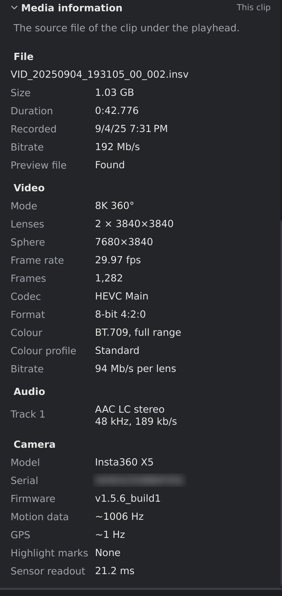

# Media information

The **Media information** section, at the bottom of the settings sidebar's
**Video** tab, shows what's inside a clip's `.insv` file: how it was
recorded, by which camera, and in what format. It starts folded: click its
title to open it. It only shows information; nothing here can be changed.

It shows the file of the clip you selected on the video track, or of the
clip under the playhead if none is selected. With no clip, it's empty.
While a file from the **Media** tab is previewed
([Previewing a file](main-window.md#previewing-a-file)), it shows that file
instead, and says *Previewed file* at its top right.

*An 8K clip recorded on an X5. The camera's serial number is blurred here.*

Hover over a value to see more about it, where there is more: the file's
full path, or what a value means.

## File

| Row | What it shows |
|---|---|
| (file name) | The name of the `.insv` file (for a ONE X2 5.7K clip, the front lens's `VID_…_00_…`). Hover over it for the full path. |
| **Size** | The file's size on disk. |
| **Duration** | How long the file is, in minutes, seconds and thousandths, before any trimming. For a recording in several files, the first file's; the whole recording's is under *Recording*. |
| **Recorded** | When the recording started, by the camera's clock: the time the camera showed. For a video that isn't from a 360 camera, the time the file says, in your computer's time zone. |
| **Bitrate** | How much data the file holds per second of video, sound included. Higher means more detail, and larger files. |
| **Back lens file** | Only for a clip whose back lens is in a file of its own (the Insta360 ONE X2's 5.7K clips): that file's name. Hover over it for the full path. The clip needs it, in the same folder. |
| **Preview file** | Whether the camera's low-resolution preview file (`.lrv`, the ONE X2's `LRV_…_11_….insv`, or the Antigravity A1's `PRX_….prx`) is next to the `.insv`. orbis-reframe doesn't need it, so *Not found* is fine. |

## Recording

Only for a recording the camera split over several files (the X5 starts a
new file every 29 min 59 s; see [The timeline](timeline.md#adding-clips)),
which is one clip.

| Row | What it shows |
|---|---|
| **Length** | How long the whole recording is, every file of it: the clip's length before trimming. |
| **Files** | Each file of the recording, in order, with where it plays in the clip, such as *29:59.798 – 37:25.376*. A file that's gone says *⚠ not here*: that stretch of the clip plays black and silent, and can't be exported (see [Where the clips are](projects-and-export.md#where-the-clips-are)). *A file that isn't here* is a gap between two files that are: a file of the recording that wasn't in the folder when you added it. Hover over a file for its full path. |
| **Starts in** | When the clip was added from a later file of the recording and the first file isn't in the folder: the first file's name, *⚠ Not here*. The clip starts where the file you added does. Added from the first file, the whole recording comes in as a clip of its own. |
| **May go on in** | When the last file is as long as the camera makes one, and the next file isn't in the folder: that file's name. The files don't say whether the recording went on, so this is a guess: if you have the file, put it beside the others before adding the clip. |

## Video

| Row | What it shows |
|---|---|
| **Mode** | The recording mode: **8K**, **5.7K** or **4K** 360° on the X5, **8K**, **6K** or **4K** on the X6, **5.7K** on the ONE X2, **8K**, **5.2K** or **4K** on the Antigravity A1. Read from the size of the lens pictures. The X5's 5.7K+ records pictures the same size as 5.7K, so it shows as 5.7K. |
| **Lenses** | The size of each of the two fisheye pictures, in pixels. |
| **Sphere** | The size of the whole 360° picture once the two are stitched together, as a flat world-map image. |
| **Frame rate** | Frames per second, such as 29.97, 59.94 or 119.88. |
| **Slow motion** | On a clip filmed in slow motion (the Antigravity A1's 4K Slow Motion): the rate the camera filmed at, such as *Filmed at 100 fps*. The file stores the frames at the frame rate above, so the clip plays that much slower than it happened; hover over the row for how much. |
| **Timelapse** | On a timelapse: how often the camera took a frame, such as *A frame every 2.0 s*; hover over the row for how long the recording took. |
| **Frames** | How many frames the recording has. |
| **Codec** | How the video is compressed: **HEVC** (H.265) or **H.264**, with its profile. |
| **Format** | Bits per colour (8 or 10) and how the colour is stored (4:2:0). |
| **Colour** | The colour standard (BT.709, BT.2020), the HDR format if the video is HDR (HLG or PQ), and whether the levels use the full or the limited range. |
| **Colour profile** | The colour profile the camera filmed in: **Standard**; a log profile such as **I-Log** (Insta360's); or an HDR mode, with its HDR format, such as **Dolby Vision (HLG)** (the Insta360 X6's). A log or HDR clip looks flat until you give it a LUT: the one the camera maker publishes for a log profile, **HLG to Rec.709** for HLG (see [LUTs](colour.md#luts)). Shown when the camera writes it into the file, or when the video is HDR. |
| **Bitrate** | The video's data rate, for each of the two lens pictures. |

## Audio

One row for each sound recording in the file: **Track 1**, and **Track 2**
for a clip with an external microphone (on the timeline, the *External mic*
and *Camera mic* tracks; see [Audio and noise reduction](audio.md)). Each row shows the
format (usually AAC), the channels (mono or stereo), the sample rate and
the data rate.

## Camera

| Row | What it shows |
|---|---|
| **Model** | The camera that recorded the file, such as *Insta360 X5*. |
| **Serial** | The camera's serial number. Blur it out if you share a screenshot of this section. |
| **Firmware** | The camera's software version at the time of recording. |
| **Motion data** | How often the camera recorded its movement, which [stabilization](stabilization.md) works from: about 1000 times a second on the X5. *Orientation per frame* on an X5 timelapse, which records which way the camera pointed at each frame instead. *Not recorded* means stabilization can't work for this clip. |
| **GPS** | Whether a GPS source, such as Insta360's GPS remote, recorded where you were: how often the position was updated (about once a second), or *Not recorded*. A second line says when the track covers only part of the recording, for example because the signal was lost, or *no position fix* if the GPS never found its position. The positions themselves aren't shown, so a screenshot of the section doesn't give away where you rode. An Antigravity A1 records its GPS too; titles and gauges use it once the drone has moved (see [Getting started](getting-started.md)). |
| **Highlight marks** | How many moments were marked while recording, or *None*. They show as yellow dots on the clip in the timeline (see [The timeline](timeline.md#highlight-marks)). |
| **Sensor readout** | How long the camera's sensor takes to read one picture from top to bottom (the rolling shutter). orbis-reframe uses it to straighten the picture during fast movement. |

## When it's useful

- **Checking a clip before editing:** the mode, frame rate and length, for
  example to find the 120 fps clips for slow motion.
- **Reporting a problem:** the mode, codec and firmware help pin down a bug.
  The diagnostics in **Help ▸ About orbis-reframe** describe your computer;
  this section describes the clip.
- **If a clip won't open:** the section shows **Error** with the reason, such
  as *file not found*.
