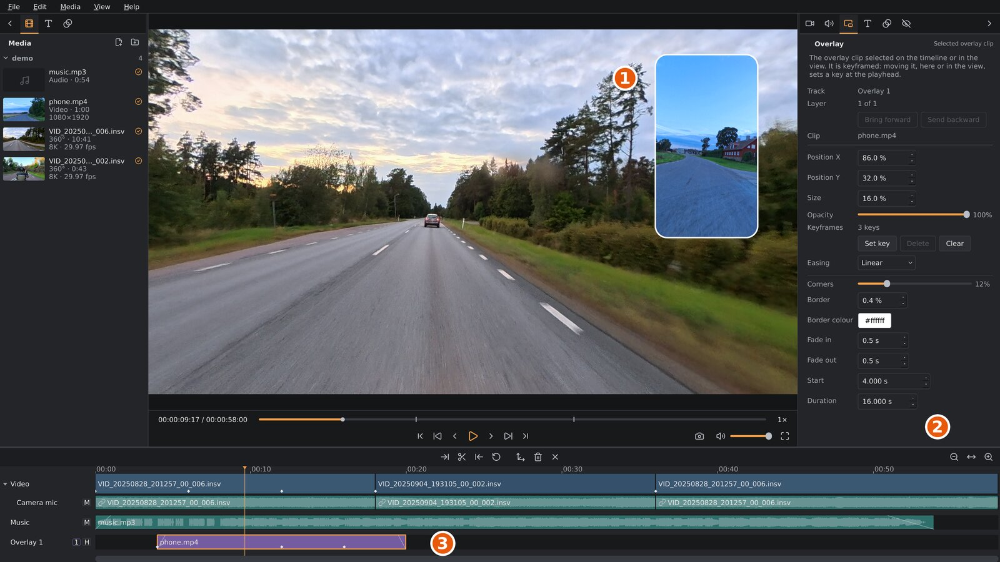

# Overlays

An overlay is an ordinary flat video shown in a small frame over your 360°
video: a picture-in-picture. Use it for a second camera, such as a phone on
the handlebars, an action camera pointing at the rider, or a screen
recording of your route.

1. The overlay in the viewport. Drag it to move it.
2. The settings sidebar's **Overlay** tab, with the settings of the selected overlay.
3. The overlay clip on its overlay track. The white diamonds are its
   keyframes.

## Adding an overlay

Overlays go on overlay tracks, the lowest tracks on the timeline. Add one with **Media ▸
Add video overlay…** (`Ctrl+Shift+V`), by right-clicking the timeline and
choosing **Add video overlay here…**, or by dragging video files from the
**Media** tab or your file manager onto the timeline. Overlays take `.mp4`, `.mov`, `.mkv`,
`.m4v`, `.webm` and `.avi` files. More about overlay tracks (moving,
trimming, splitting, hiding a track) is in [The timeline](timeline.md).

A new overlay starts in the lower right corner, at 30 % of the picture's
width.

An overlay video with sound brings it along: the sound goes onto the
overlay track's own audio track, right under it (*Overlay 1 audio*),
linked to the overlay so it stays in step. Move the overlay to another
overlay track and its sound moves to that track's audio track. Select the overlay to set
its sound's level, noise reduction and fades in the **Audio** tab (see
[Audio and noise reduction](audio.md)). If you've removed the sound,
right-click the overlay and choose **Put its sound on an audio track** to
get it back.

## Selecting an overlay

Click the overlay clip on the timeline, or click the overlay itself in the
viewport. The **Overlay** tab then shows its settings. With no overlay
selected, the tab is greyed out.

## Position, size and opacity

- **Move it:** drag the overlay in the viewport. The pointer turns into a
  four-way arrow over an overlay. Or type **Position X** and **Position
  Y**: where the overlay's centre is, as a percentage of the picture's width
  and height (0 % is the left or top edge, 100 % the right or bottom edge).
  An overlay can hang partly off the edge.
- **Size**: the overlay's width, as a percentage of the picture's width. Its
  height follows the shape of the video: a phone video filmed upright gives
  a tall overlay.
- **Opacity**: 100 % is solid; lower values let the 360° video show through.

The position, size and opacity are stored as shares of the picture, so they
stay right if you change the project's resolution or aspect ratio later
(though the overlay may then cover a different part of the picture).

## Moving an overlay during a clip

Without keyframes, an overlay keeps one position, size and opacity for the
whole clip. With **keyframes** it can move, grow, shrink or fade during the
clip: you set the look at a few moments, and the overlay moves at an even
pace from one to the next. This works like the reframe keyframes of the
360° view ([Reframing](reframing.md)).

1. Select the overlay, and move the playhead to where a change should start.
2. Click **Set key** (or press `K`). The overlay's current position, size
   and opacity are stored at the playhead.
3. Move the playhead to where the change should end, and move, resize or
   fade the overlay. Once an overlay has keyframes, every change you make, in
   the tab or by dragging it in the viewport, sets a keyframe at the
   playhead.
4. Play to check, and add keyframes in between to shape the movement.

**Keyframes** in the tab says how many the overlay has.

- **Delete** (or `Shift+K`) removes the keyframe at the playhead (within
  0.15 seconds of it).
- **Clear** removes all keyframes. The overlay stays as it looks at the
  playhead.

With keyframes, the playhead has to be inside the overlay clip to change
the overlay: a change needs a moment to store its keyframe at.

While an overlay clip is selected, `K` and `Shift+K` work on its keyframes,
not the video clip's reframe keyframes. Click the video track (or press
`Esc`) to get back to those.

> `Delete` on the keyboard removes the selected overlay **clip**, not a
> keyframe. Use `Shift+K` or the **Delete** button in the tab for
> keyframes. **Edit ▸ Undo** (`Ctrl+Z`) brings back anything removed by
> mistake.

## The frame

These settings are the same for the whole clip:

| Setting | What it does |
|---|---|
| **Corners** | Rounds the corners. 0 % gives sharp corners; 50 % makes the short sides fully round. |
| **Border** | A border around the overlay, as a share of the picture's height. 0 % is no border; 0.5 % is about 5 pixels in a 1080p video. |
| **Border colour** | Click to choose the border's colour. |
| **Fade in** / **Fade out** | Fades the overlay in at the start of the clip, or out at its end, over this many seconds. |
| **Start** | Where the clip starts on the timeline, in seconds. |

## Several overlays

You can show several overlays at once, on separate overlay tracks. Where
they overlap, the one on the higher track is drawn on top. To hide all
overlays on a track for a while, click the **H** box in its track header.

Overlays appear in playback, screenshots and the export exactly as in the
viewport. The colour settings of the 360° clip don't change them, and
stabilization doesn't move them.
