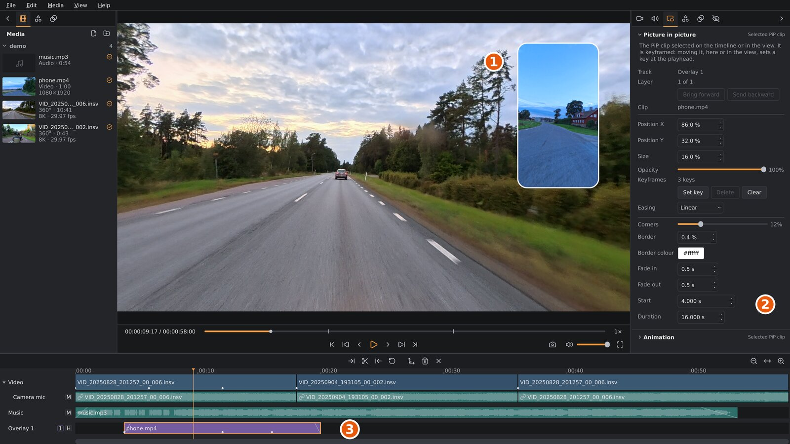

# Picture in picture

A picture in picture (PiP) is an ordinary flat video shown in a small frame
over your 360° video. Use it for a second camera, such as a phone on the
handlebars, an action camera pointing at the rider, or a screen recording
of your route.

A PiP is one kind of *overlay*: anything on an overlay track. The other
kind is a title ([Titles](titles.md)).

1. The PiP in the viewport. Drag it to move it.
2. The settings sidebar's **Picture in picture** tab, with the settings of the selected PiP.
3. The PiP clip on its overlay track. The white diamonds are its
   keyframes.

## Adding a picture in picture

PiPs go on overlay tracks, the lowest tracks on the timeline. Add one with **Media ▸
Add picture in picture…** (`Ctrl+Shift+V`), by right-clicking the timeline and
choosing **Add PiP here…**, or by dragging video files from the
**Media** tab or your file manager onto the timeline. A PiP takes `.mp4`, `.mov`, `.mkv`,
`.m4v`, `.webm` and `.avi` files. More about overlay tracks (moving,
trimming, splitting, hiding a track) is in [The timeline](timeline.md).
To use a flat video as the main picture instead of a small frame, put it on
the video track ([Flat videos on the video track](timeline.md#flat-videos-on-the-video-track)).
For text over the video, see [Titles](titles.md): titles go on overlay
tracks too, and most of this chapter applies to them.

A new PiP starts in the lower right corner, at 30 % of the picture's
width.

A PiP video with sound brings it along: the sound goes onto the
overlay track's own audio track, right under it (*Overlay 1 audio*),
linked to the PiP so it stays in step. Move the PiP to another
overlay track and its sound moves to that track's audio track. Select the PiP to set
its sound's level, noise reduction and fades in the **Audio** tab (see
[Audio and noise reduction](audio.md)). If you've removed the sound,
right-click the PiP and choose **Put its sound on an audio track** to
get it back.

## Selecting a picture in picture

Click the PiP clip on the timeline, or click the PiP itself in the
viewport. The **Picture in picture** tab then shows its settings. With no PiP
selected, the tab is greyed out. A title's settings are on a tab of their
own, the **Overlay** tab ([Titles](titles.md)).

## Position, size and opacity

- **Move it:** drag the PiP in the viewport. The pointer turns into a
  four-way arrow over a PiP. Or type **Position X** and **Position
  Y**: where the PiP's centre is, as a percentage of the picture's width
  and height (0 % is the left or top edge, 100 % the right or bottom edge).
  A PiP can hang partly off the edge.
- **Size**: the PiP's width, as a percentage of the picture's width. Its
  height follows the shape of the video: a phone video filmed upright gives
  a tall PiP.
- **Opacity**: 100 % is solid; lower values let the 360° video show through.

The position, size and opacity are stored as shares of the picture, so they
stay right if you change the project's resolution or aspect ratio later
(though the PiP may then cover a different part of the picture).

## Moving a picture in picture during a clip

Without keyframes, a PiP keeps one position, size and opacity for the
whole clip. With **keyframes** it can move, grow, shrink or fade during the
clip: you set the look at a few moments, and the PiP moves from one to
the next. This works like the reframe keyframes of the 360° view
([Reframing](reframing.md)).

1. Select the PiP, and move the playhead to where a change should start.
2. Click **Set key** (or press `K`). The PiP's current position, size
   and opacity are stored at the playhead.
3. Move the playhead to where the change should end, and move, resize or
   fade the PiP. Once a PiP has keyframes, every change you make, in
   the tab or by dragging it in the viewport, sets a keyframe at the
   playhead.
4. Play to check, and add keyframes in between to shape the movement.

**Keyframes** in the tab says how many the PiP has.

- **Delete** (or `Shift+K`) removes the keyframe at the playhead (within
  0.15 seconds of it).
- **Clear** removes all keyframes. The PiP stays as it looks at the
  playhead.
- **Easing** sets how the PiP moves from the keyframe at the playhead
  (or the last one before it) to the next: **Linear** (an even pace),
  **Fast to slow** (slows down into the next keyframe) or **Slow to fast**
  (starts slowly and speeds up). It works like the easing of reframe
  keyframes ([Easing](reframing.md#easing)), including the gentle start
  and stop of every move, and is greyed out where the
  playhead isn't between two keyframes. New keyframes are linear.

With keyframes, the playhead has to be inside the PiP clip to change
the PiP: a change needs a moment to store its keyframe at.

Trimming or splitting a PiP clip deletes the keyframes it leaves
outside the clip, as for reframe keyframes
([Keyframes](reframing.md#keyframes)). If none are left, the PiP keeps
the look it had at the clip's new start.

While a PiP clip is selected, `K` and `Shift+K` work on its keyframes,
not the video clip's reframe keyframes. Click the video track (or press
`Esc`) to get back to those.

> `Delete` on the keyboard removes the selected PiP **clip**, not a
> keyframe. Use `Shift+K` or the **Delete** button in the tab for
> keyframes. **Edit ▸ Undo** (`Ctrl+Z`) brings back anything removed by
> mistake.

## The frame

These settings are the same for the whole clip:

| Setting | What it does |
|---|---|
| **Corners** | Rounds the corners. 0 % gives sharp corners; 50 % makes the short sides fully round. |
| **Border** | A border around the PiP, as a share of the picture's height. 0 % is no border; 0.5 % is about 5 pixels in a 1080p video. |
| **Border colour** | Click to choose the border's colour. |
| **Fade in** / **Fade out** | Fades the PiP in at the start of the clip, or out at its end, over this many seconds. |
| **Start** | Where the clip starts on the timeline, in seconds. |
| **Duration** | How long the clip shows, in seconds. Its start stays put and its end moves, like dragging its end on the timeline; a PiP video can't run past the end of its file. |

## Several overlays

You can show several overlays (PiPs, titles and gauges) at once, on separate overlay tracks,
with no fixed limit. Each overlay keeps its picture in graphics memory while
it's on screen; if the graphics card runs out, the overlays it has no room
for are left out of the viewport (the export still has them), and the app's
log says so. Each overlay track is a **layer**, numbered in the small box in
its track header:
layer **1** is in front, and each number after it is drawn behind the one
before. Where overlays overlap, the one on the lower-numbered layer covers
the other. The first overlay track on the timeline is always layer 1.
Hover over the number to see where the track sits.

To change the order, select a PiP and click **Bring forward** or
**Send backward** next to **Layer** in the Picture in picture tab (or a
title's **Overlay** tab). The tab also shows
the layer, for example *1 of 2 (front)*; hover over it to see which tracks
are in front and behind. You can also right-click an overlay track and
choose **Bring forward** / **Send backward**, or drag its track header up
or down. The whole track moves, with its audio track, so every overlay on
it changes layer.

To hide all overlays on a track for a while, click the **H** box in its
track header.

PiPs appear in playback, screenshots and the export exactly as in the
viewport. The colour settings of the 360° clip don't change them, and
stabilization doesn't move them.
