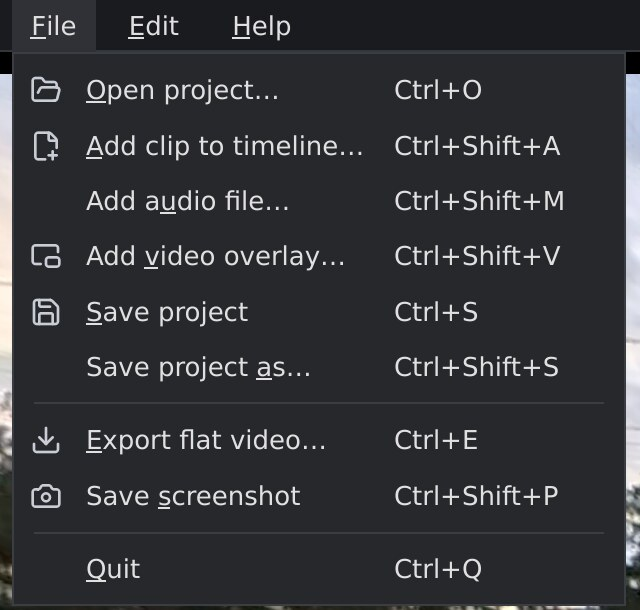
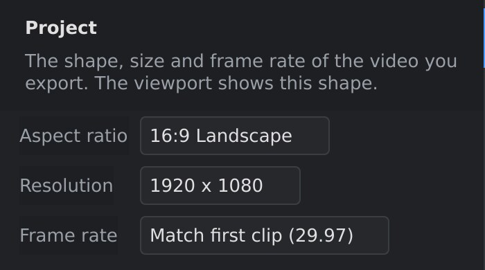
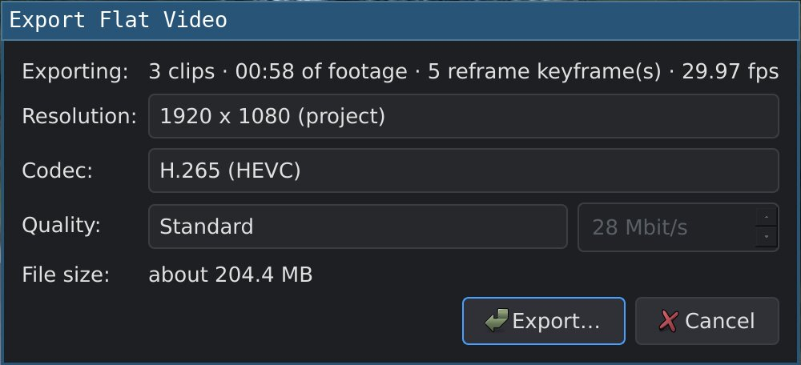

# Projects and export

This page covers saving your work as a project, the project's output
settings, exporting the finished video, and saving single frames as
pictures.

## Projects

A project holds your whole edit: the clips and their order, trims and
speeds, reframe keyframes, the stabilization, stitching, colour, audio and
privacy settings, the audio and overlay tracks, and the output settings.
Projects are saved as `.orp` files.

| To | Do |
|---|---|
| Save the project | **File ▸ Save project** (`Ctrl+S`). The first time, it asks for a name and a folder. |
| Save it under another name | **File ▸ Save project as…** (`Ctrl+Shift+S`). From then on, `Ctrl+S` saves to the new file. |
| Open a project | **File ▸ Open project…** (`Ctrl+O`), or give the `.orp` file on the command line: `orbis-reframe my-ride.orp`. |

The window's title shows the project's name, with a `*` while there are
unsaved changes. There's no automatic saving: save regularly. When you
close orbis-reframe or open another project with unsaved changes, it asks
whether to save them.

### Where the clips are

A project doesn't contain the video and audio files: it remembers where they
are. Your original files are never changed.

- **Keep the files where they are.** If a file is moved or renamed after you
  added it, the project can't find it. When you open the project, it says
  *Missing media* and the clip can't play. Put the file back where it was
  (with its old name) and open the project again.
- **Save the project in the folder with your clips**, or in a folder above
  it. orbis-reframe then stores the clips' places relative to the project,
  so you can move or copy the whole folder, for example to another disk or
  computer, and the project still finds everything.

Measurements orbis-reframe makes for each clip (gyro sync and seam
alignment) are saved in the project. Privacy-blur scans are kept in
`~/.cache/orbis-reframe/` instead: on another computer, scan the clips
again.

## Project settings

The **Project** panel sets the shape, size and frame rate of the video you
make:

| Setting | What it does |
|---|---|
| **Aspect ratio** | The shape of the picture: **16:9 Landscape** (YouTube, TV), **9:16 Vertical** (phone, Shorts, Reels, TikTok), **1:1 Square**, or **4:3**. The viewport takes this shape at once, so you see exactly what will be exported. |
| **Resolution** | The export's size. Each aspect ratio has four sizes, from 720p to 4K (2160p): for 16:9, 1280 × 720, 1920 × 1080, 2560 × 1440 and 3840 × 2160. The export can still pick another size. |
| **Frame rate** | The export's frames per second. **Match first clip** uses the frame rate of the first clip on the video track. Or pick 23.976, 24, 25, 29.97, 30, 50, 59.94 or 60. |

Changing the aspect ratio keeps your reframe keyframes: the camera still
looks in the same directions, only the picture is cut to another shape.
Check your framing afterwards, especially when changing between landscape
and vertical.

**Frame rate and clips.** Each clip is played at the project's frame rate.
A clip filmed at a higher rate has frames left out, and one filmed at a
lower rate has frames shown twice; frames aren't blended. Slow motion uses
this: a 120 fps clip at 0.25× speed in a 30 fps project shows every frame it
recorded (see [The timeline](timeline.md)).

## Exporting the video

**File ▸ Export flat video…** (`Ctrl+E`) turns the whole timeline into a
normal, flat MP4 video that plays anywhere.

1. Choose **File ▸ Export flat video…**.
2. The dialog sums up what will be exported: how many clips, how long, how
   many reframe keyframes, and the frame rate.
3. Pick the **Resolution**: the project's size is selected; the others have
   the same aspect ratio.
4. Pick the **Codec**:
   - **H.265 (HEVC)**: smaller files at the same quality. Plays on current
     phones, computers and TVs, and YouTube accepts it.
   - **H.264**: plays on almost everything, including older devices and
     some editing programs that don't take H.265. Files are larger.
5. Pick the **Quality**:
   - **Standard**: enough for uploading and further editing.
   - **Smaller file**: half Standard's bitrate, for sharing when size
     matters. Busy scenes, like trees and gravel rushing by, can look soft.
   - **High**: twice Standard's bitrate, for footage you'll edit or
     re-encode again.
   - **Custom**: type the bitrate in Mbit/s (1 to 300).

   The box next to it shows the bitrate in Mbit/s, and **File size** the
   approximate size of the finished file. Your choice is remembered for the
   next export.
6. Click **Export…** and choose where to save the file.
7. A progress window shows how far the export has come. **Cancel** stops it
   and deletes the unfinished file.

When it's done, orbis-reframe says where it wrote the file.

### What goes into the export

Everything you see and hear in playback: every clip on the video track with
its trims, speed, reframe keyframes, stabilization, colour and privacy blur;
the overlays; and the sound of the clips and the audio tracks, with their
levels, fades and noise reduction. Muted tracks and clips stay silent, and
hidden overlay tracks are left out.

The export runs from the start of the first clip on the video track to the
end of the last one. There's no way to export only part of the timeline
yet: to export a part, save the project under another name and trim it.

The quality levels' bitrates depend on the resolution, frame rate and
codec. **Standard** is 40 Mbit/s for 1080p at 30 fps in H.264, about
120 Mbit/s at 4K; 60 fps gets about one and a half times as much, and
H.265 30 % less, because it needs fewer bits for the same picture. The
sound is AAC, stereo, at 48 kHz and 192 kbit/s.

### When the export won't start

| Message | What to do |
|---|---|
| *Exporting needs NVIDIA's hardware video encoder (NVENC)* | Export uses the NVIDIA graphics card to encode. Install `libnvidia-encode1` ([Getting started](getting-started.md), step 2). Without an NVIDIA card, exporting isn't possible yet. |
| *"…" has the privacy blur on, but it hasn't been scanned for plates yet* (or *only part of it has been scanned*) | Scan that clip in the **Privacy** panel, or turn its blur off. See [Privacy blur](privacy.md). |
| *The privacy blur may be out of date and needs checking or redoing.* | The stabilization was changed after the plates were found. **Continue anyway**, or check the blurs first. See [Privacy blur](privacy.md). |
| *The timeline is too short to export.* | The timeline is shorter than a tenth of a second. |

> **Look at the summary.** If it says *no keyframes — static forward view*,
> none of your clips has a reframe keyframe, and the whole video looks
> straight ahead from the camera. If only some clips have keyframes, the
> dialog lists the others under **Not reframed**, by number, name and
> where they start on the timeline. See [Reframing](reframing.md).

## Screenshots

**File ▸ Save screenshot** (`Ctrl+Shift+P`), or the camera button in the
transport bar, saves the frame at the playhead as a PNG picture, at the
project's resolution, with the same quality as the export: the viewport's
current view, with stabilization, colour, privacy blur and overlays.

The suggested file name is the project's name and the playhead's time, in
the project's folder (or in your Pictures folder while the project hasn't
been saved yet). The transport bar says when the picture is saved.
