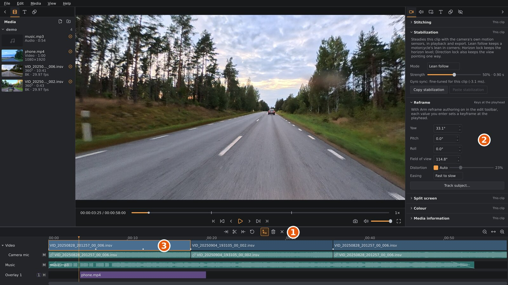
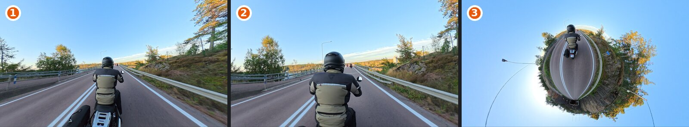
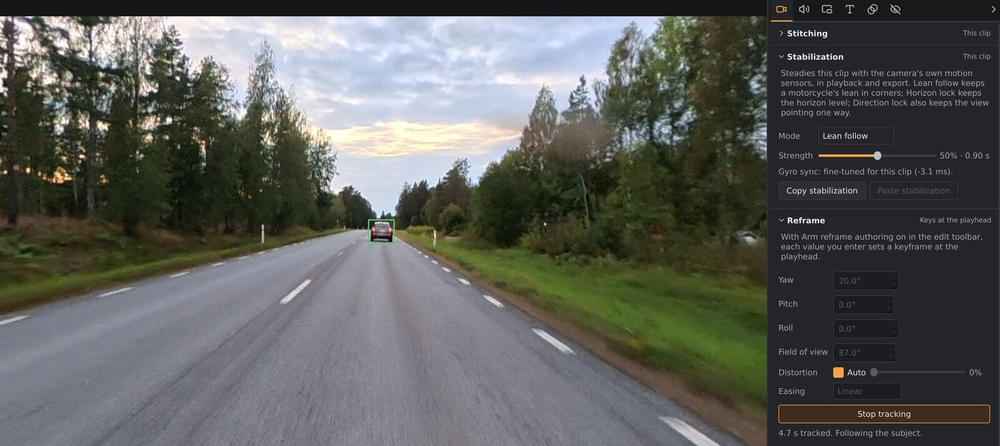
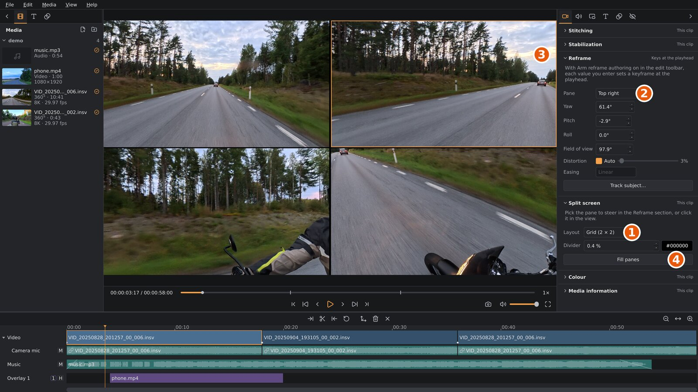

# Reframing

A 360° clip records everything around the camera. Reframing chooses what
your flat video shows: where the virtual camera looks at each moment, and
how wide its view is. You do this with **reframe keyframes**: you set the
view at a few moments, and orbis-reframe moves the camera smoothly from one
to the next. **Track subject** can also set the keyframes for you, by
following a person or vehicle. With **split screen**, one clip shows two or
four views at once.

1. The edit toolbar, with **Arm reframe authoring** on: the button
   outlined in orange. While it's on, every look-around in the viewport
   sets a keyframe.
2. The **Reframe** section: the view at the playhead as numbers, and
   **Track subject…**.
3. The clip's keyframes: the white diamonds along the bottom of the clip.

## The view

The view has five settings. You can see and type them in the **Reframe**
section (settings sidebar, **Video** tab):

| Setting | What it is | Range |
|---|---|---|
| **Yaw** | Left / right: the compass direction the camera looks in. 0° is straight ahead of the camera. | −180° to 180° |
| **Pitch** | Up / down. 0° is level, 90° straight up. | −89° to 89° |
| **Roll** | Tilts the picture, like tilting your head. Usually 0°. | −180° to 180° |
| **Field of view** | How much the view takes in, from one corner of the picture to the opposite one. Small values zoom in, large values give a wide view. | 20° to 330°, depending on **Distortion** |
| **Distortion** | How a wide view is drawn: **Auto**, or a fixed amount from 0 % to 100 % (see [Wide views and tiny planets](#wide-views-and-tiny-planets)). | Auto, 0 % to 100 % |

In the viewport, dragging changes yaw and pitch, and the mouse wheel changes
the field of view. Roll and distortion can only be set in the section.

The field of view is measured corner to corner, so the same value takes in
as much in a landscape picture as in a portrait one; only the shape of the
picture differs. The project's aspect ratio (**File ▸ Project settings…**)
sets that shape. Changing the aspect ratio later keeps your keyframes; the
corners stay where they were, the edges of the picture move.

### Wide views and tiny planets

1. 140° at 0 %: straight lines stay straight, but the rider in the middle
   is small and everything toward the edges is stretched.
2. The same 140° at **Auto**: the middle is larger and the edges are no
   longer stretched; lines away from the middle bend a little.
3. A tiny planet: pitch −89° (straight down), field of view 300°.

A normal camera view keeps straight lines straight. That works up to a
field of view of about 90°; wider, the edges of the picture stretch more and
more, and the middle shrinks. **Distortion** draws a wide view the way a
fisheye lens would instead: the edges keep their shapes, and lines away from
the middle bend.

With **Auto** ticked (the default), the distortion follows the field of
view: none up to about 90°, rising to full at 170° and wider. The slider
shows the amount Auto uses. Untick **Auto** to set the amount yourself with
the slider: 0 % keeps every line straight, 100 % keeps every shape. The
widest field of view depends on the amount: 145° at 0 %, 330° at 100 % or
with Auto. Lowering the amount narrows a view that is wider than it allows.

For a **tiny planet**, look straight down (pitch −89°) and widen the field
of view to 250° or more: the ground curls into a small globe with the sky
around it. Looking straight up instead turns the sky into a tunnel. A
keyframe move from a normal view to a tiny planet zooms out smoothly, and
with Auto on both keyframes the picture bends more and more as it widens.

> **Projects from earlier versions** keep their views: each keyframe takes
> the corner-to-corner angle that frames what it framed before, with
> distortion on Auto. Views wider than about 90° corner to corner now
> look less stretched at the edges; that is most of them, since the old
> default, 75° from top to bottom, is 115° corner to corner in a 16:9
> picture. To get the old look back, untick **Auto** and set 0 %.

## Keyframes

A keyframe stores the view (yaw, pitch, roll, field of view and distortion)
at one moment of a clip. Between two keyframes the camera turns and zooms from one
view to the other, the short way round, at the pace the first keyframe's
**Easing** sets (see [Easing](#easing)). Distortion changes along with the
field of view: between two keyframes on **Auto** it follows the field of view
as it zooms; otherwise it moves from one keyframe's amount to the other's. Before a clip's first keyframe the
view stays as at that keyframe, and after the last keyframe it stays as at
the last one.

Each clip has its own keyframes, stored with the clip. They move with the
clip when you reorder or trim it, and a split clip's halves both keep the
keyframes that fall inside them. A keyframe that a trim leaves exactly on
the clip's end shows its diamond on the clip's last frame, where clicking it
or `Shift+↓` takes the playhead and you can change or delete it like any
other. One a trim leaves outside the clip has no diamond until you trim the
clip back over it, but it still steers the view toward it up to the clip's
last frame.

> **A clip without keyframes is exported looking straight ahead** (yaw 0°,
> pitch 0°, field of view 115°, distortion Auto), whatever you looked at in
> the viewport. Give
> every clip at least one keyframe. A clip without any shows a hollow
> diamond (◇) before its name on the timeline, the **Reframe** section warns
> while the playhead is in it, and the export dialog lists it.

### Setting keyframes

The simplest way, for a clip that should look in one direction all the
time:

1. Move the playhead into the clip.
2. Drag in the viewport until the view is right, and zoom with the mouse
   wheel.
3. Press `K`. This sets a keyframe with the current view at the playhead.

To make the camera move during a clip, set more keyframes:

1. Click **Arm reframe authoring** in the edit toolbar, or press `A`.
2. Move the playhead to where a move should start, and drag the view into
   place. When you let go of the mouse button, a keyframe is set at the
   playhead. Turning the mouse wheel sets one too.
3. Move the playhead to where the move should end, and drag the view into
   its new place. A second keyframe is set.
4. Play the clip to check the move. Add keyframes in between to shape it.
5. Click **Arm reframe authoring** again (or press `A`) to turn it off, so that looking
   around no longer changes your keyframes.

Pause before you set keyframes: they go in at the frame the playhead is on.
If there's already a keyframe at that frame, its view is replaced instead
of a second keyframe being added.

You can also type exact values into the **Reframe** section. With reframe
authoring armed, each value you enter sets a keyframe at the playhead, the
same as a drag. Without it, the values only change what the viewport shows.

### Looking around without changing anything

Without reframe authoring armed, you can drag in the viewport freely to
look around, for example to find your next subject. Your keyframes don't
change. Once the clip plays or you move the playhead, the view goes back to
following the keyframes.

### Changing and deleting keyframes

- **Go to a keyframe:** `Shift+↓` and `Shift+↑` move the playhead to the
  next and previous keyframe, across all clips. Or click a keyframe's
  diamond on the clip -- it highlights under the pointer -- to move the
  playhead to it directly.
- **Change a keyframe:** move the playhead onto it, and set the view again
  (with reframe authoring armed, or by pressing `K`). The keyframe's view is
  replaced.
- **Delete a keyframe:** move the playhead onto it, and press `Shift+K` or
  click **Delete keyframe** in the edit toolbar. The playhead doesn't have
  to be on the exact frame: a keyframe within 0.15 seconds is deleted.
  `Delete` does the same when no clip is selected.
- **Delete all keyframes of a clip:** move the playhead into the clip, and
  click **Delete all keyframes** in the edit toolbar (`Ctrl+Shift+K`).

**Edit ▸ Undo** (`Ctrl+Z`) undoes keyframe changes like any other edit.

### Easing

**Easing** in the **Reframe** section sets how the camera moves from one
keyframe to the next:

| Easing | The move |
|---|---|
| **Linear** | At an even pace. |
| **Fast to slow** | Starts fast and slows down, coming to rest at the next keyframe. Good for settling on a subject. |
| **Slow to fast** | Starts slowly from rest and speeds up into the next keyframe. Good for leaving a view. |

Whatever the easing, a move never starts or stops abruptly. Where the
camera starts moving, it speeds up gently from rest over the first quarter
of the move; where it comes to a stop, it slows down gently over the last
quarter. That's at a clip's first and last keyframe, and at a keyframe
with the same view as the one before or after it (a hold). Where the move
carries on through a keyframe to the next, it keeps going without slowing
down.

Each keyframe has its own easing, for the move from it to the next keyframe.
Move the playhead onto a keyframe, or anywhere between it and the next one,
and pick the easing: it applies to that move. The field shows the easing of
the move the playhead is in, and is greyed out before a clip's first
keyframe and from its last keyframe on, where nothing moves. Choosing an
easing doesn't need reframe authoring armed.

New keyframes, and the keyframes **Track subject** sets, are linear. A
keyframe keeps its easing when you change its view.

## Track subject

Track subject follows a person, vehicle or other subject through the clip
and sets the keyframes for you, so the camera keeps it in view.

1. Move the playhead to where tracking should start. The subject has to be
   visible there.
2. Look around in the viewport until the subject is in view.
3. Click **Track subject…** in the **Reframe** section, or press `T`.
   Playback pauses.
4. Drag a box around the subject in the viewport. Fit it closely: a box
   with a lot of background around the subject is easier to lose. (`Esc`
   cancels.)
5. Tracking starts. The viewport plays the clip, with the camera following
   the subject and a box drawn around it: **green** while the tracker is
   sure it has the subject, **red** while it has lost it. The **Reframe**
   section shows how far it has come.
6. Tracking runs to the end of the clip. To stop earlier, click **Stop
   tracking**, or press `Space`, `Esc` or `T`.

The camera only turns to follow the subject. It keeps the field of view,
distortion and roll of the view you drew the box in, so choose the zoom
before you start.

When tracking ends, the tracked path is turned into keyframes, from the
start of tracking to the last frame where the subject was seen. They replace
any keyframes the clip had in that stretch. Keyframes before and after it
stay. The playhead is left at the end of the tracked stretch, and the
edit toolbar says how many seconds and keyframes were tracked.

**If the subject is lost.** When the subject is hidden for a while (behind
a truck, a tree, or out of sight), the box turns red. Tracking goes on and
may find the subject again. If it doesn't, stop it: the keyframes run up to
where the subject was last seen, and the playhead waits there. Move the
playhead to where the subject is visible again and track again from there.

The tracked keyframes are ordinary keyframes. You can change or delete any
of them, add your own, or delete them all and try again.

**If Track subject is greyed out.** With a note under the button, the
tracking model is missing from the installation: install orbis-reframe
again. Without a note, the timeline is empty or an export is running.

Tracking works on the stabilized picture, so a shaking camera doesn't throw
it off. It works best with a subject that stands out from its background
and isn't too small in the view.

## Split screen

A clip's picture can be split into two or four **panes**. Each pane shows
the same 360° clip from its own direction, with its own keyframes: the road
ahead and the road behind at once, or the four sides of the camera.

1. **Layout**, in the **Split screen** section: one picture or how the
   panes are arranged.
2. **Pane**, in the **Reframe** section: the pane you're steering, the
   *active pane*.
3. The active pane, outlined in the viewport.
4. **Fill panes**: points every pane in its own direction in one go.

### Splitting a clip

1. Move the playhead into the clip, or select it.
2. In the **Split screen** section (settings sidebar, **Video** tab, under
   **Reframe**), pick a **Layout**:

   | Layout | Panes |
   |---|---|
   | **One picture** | No split: the whole picture is one view. |
   | **Side by side** | Left and right. |
   | **Stacked** | Top and bottom. |
   | **Grid (2 × 2)** | Top left, top right, bottom left, bottom right. |

The first pane keeps the clip's view and keyframes. Each new pane gets a
keyframe at the playhead that looks away from the first pane's view: back
for two panes; right, left and back for the grid, with opposite views
diagonal. A new pane's field of view is set so that the pane takes in 90°
from side to side.

Each pane has its own shape. The field of view is corner to corner, so a
very wide pane takes in a lot from side to side and little up and down.
Side by side in a 16:9 video, each pane is almost square; stacked, each is
very wide.

### Steering a pane

The **active pane** is the one with the outline in the viewport. Everything
that changes the view acts on it: dragging and the mouse wheel in the
viewport, the **Yaw**, **Pitch**, **Roll**, **Field of view**,
**Distortion** and **Easing** fields, `K`, `Shift+K` and **Delete all keyframes**, and
**Track subject…**. The keyframe diamonds on the clip are the active
pane's, and `Shift+↓` / `Shift+↑` go to its keyframes.

To make another pane active, click it in the viewport, or pick it under
**Pane** at the top of the **Reframe** section (it's there only while the
clip is split). A press on another pane also starts a drag there, so with reframe
authoring armed you can click and drag in one go. The outline is only in
the viewport, not in the export or a screenshot.

Track subject works in the active pane: draw the box in it, and the
tracked path becomes that pane's keyframes.

**Fill panes**, in the **Split screen** section, sets a keyframe at the
playhead in every pane: the first pane keeps its view, and the others look
back (two panes) or right, left and back (the grid) from it, as when you
first split the clip.

### The divider

**Divider** sets the line between the panes: its width, as a share of the
video's height (0.4 % is about 4 pixels at 1080p; 0 lets the panes touch),
and its colour.

### Split clips on the timeline

The split belongs to the clip, like its keyframes. At a cut the picture
changes to the next clip's layout. A split clip's halves and a duplicate
keep the split. A transition into or out of a split clip blends the whole
split picture.

Going back to **One picture** keeps the other panes' keyframes: pick the
layout again and they're back. **Edit ▸ Undo** (`Ctrl+Z`) undoes a split
like any other edit.

> **A pane without keyframes is exported looking straight ahead**, like a
> clip without them. The **Reframe** section warns while the playhead is
> in a clip whose active pane has none.

A project with a split clip can't be opened by orbis-reframe versions
before split screen.

## Flat videos

A flat video on the video track ([The timeline](timeline.md#flat-videos-on-the-video-track))
isn't reframed: there's nothing around it to look at. With one selected, or
under the playhead, the **Reframe** section has one setting instead of the
view and **Track subject…**:

| Fit | What you see |
|---|---|
| **Whole picture, with bars** | The whole video, with black bars where its shape differs from your video's. The default. |
| **Fill the frame, edges cropped** | The video fills the frame; what sticks out at two sides is cut off. |

A flat video isn't split into panes either: the **Split screen** section
says so instead of showing its settings.
