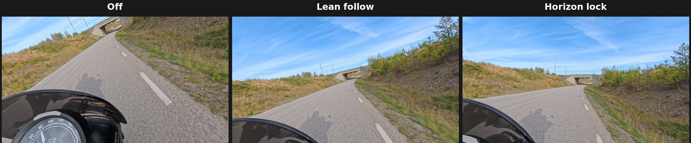
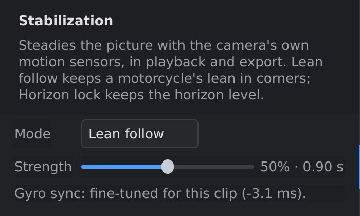
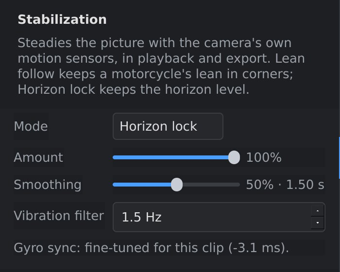

# Stabilization

The X5 records its own movement with a built-in gyroscope and
accelerometer, and stores it in every `.insv` file. orbis-reframe uses this
to steady the picture: it turns the 360° view against the camera's shake,
so the view holds still while the camera moves. It can also keep the
horizon level.

Stabilization is set in the **Stabilization** panel. The setting is the
same for the whole project, and applies to playback, screenshots and the
export alike. Nothing is re-rendered: changing it shows at once.

*The same frame in a corner, with the same reframe keyframe, in
each mode. **Off:** the view follows the camera, which leans with the bike
and points down at the road. **Lean follow:** the view is steady and points
ahead, and keeps the bike's lean into the corner. **Horizon lock:** the
horizon is level, as if the bike were upright.*

## Choosing a mode

| Mode | What it does | Use it for |
|---|---|---|
| **Off** | No stabilization: the picture moves exactly as the camera did. | Footage from a tripod or other fixed mount, or to see the raw recording. |
| **Lean follow** | Removes shake, bumps and vibration, but keeps slow movements: a motorcycle's lean in a corner, going over a crest, turning your head on purpose. | Riding: motorcycle, bicycle, skiing, anything where leaning into a turn is part of the feel. |
| **Horizon lock** | Removes all of the camera's turning and tilting, and keeps the horizon level. The view still turns with the direction you travel in, smoothly. | Helmet, handheld, boat or drone footage, where you want a level horizon and the camera's lean isn't wanted. |
| **Custom** | You set the smoothing and levelling yourself. | Fine-tuning, or special effects such as a "virtual tripod". |

A new project starts with stabilization **Off**. For most riding footage,
start with **Lean follow**; if the horizon should stay level, try **Horizon
lock**.

### Lean follow

**Strength** sets how much movement counts as shake. To the left, the view
follows the ride more closely and only fast vibration is removed. To the
right, the view is steadier and slower movements are smoothed out too. The
number after the slider is the smoothing time: movements faster than about
this are removed.

The middle setting (50 %) suits most riding. Around it, a slow lean into a
corner is kept. The top of the range is for very shaky footage, and starts
to flatten the lean as well.

"Level" in Lean follow is the camera's average position over the clip. If
the camera was mounted at a slight angle, the horizon still comes out level
when the bike is upright.

### Horizon lock

- **Amount**: how level to hold the horizon. At 100 % the virtual camera
  never tilts. Lower values let some of the camera's own (smoothed) tilt
  back in.
- **Smoothing**: how quickly the view turns when you change direction. To
  the left it follows turns closely. To the right the view is calmer, but
  lags behind in corners.
- **Vibration filter**: filters vibration out of the accelerometer before it
  is used to find the horizon. The default (1.5 Hz) suits most footage. If
  the horizon itself trembles on a vibrating mount, try a lower value;
  `0` turns the filter off.

With Horizon lock on, a reframe keyframe with a roll of 0° always gives a
level horizon, and its yaw is measured from the direction the camera faces,
smoothed: on a forward-facing mount, the direction of travel.

### Custom

Custom shows the stabilizer's own settings:

| Setting | What it does |
|---|---|
| **Smooth yaw / pitch / roll** | Smoothing time, in seconds, for turning left and right, tilting up and down, and tilting sideways. Short follows the camera closely; long holds the view still. |
| **Level horizon** | 0 keeps whatever sideways tilt is left after smoothing; 1 makes the horizon fully level. |
| **Pitch offset / Roll offset** | Tilts the result by a fixed angle, for example to correct a camera that was mounted crooked. |
| **Auto-level** | **Level to mount's average**: treats the camera's average position over the clip as level, so a crooked mount still gives a level horizon. Off: the camera body's own "up" is level. |
| **Vibration filter** | As in Horizon lock. |

Long smoothing times on all three axes (3 to 4 seconds) with **Level
horizon** at 0 give a "virtual tripod": the view hardly moves at all, while
slow changes in direction still come through.

## Gyro sync

To remove fast shake, the gyroscope's record has to line up with the
picture to about a millisecond. The camera's own timing isn't always that
exact, so orbis-reframe measures it for each clip from the video itself.
This runs in the background while playback is paused, and the result is
saved in the project, so it's only done once per clip.

The **Stabilization** panel shows the state for the clip under the
playhead:

| Message | Meaning |
|---|---|
| *Gyro sync: measuring this clip…* | The measurement is running. Stabilization already works, with the camera's timing. |
| *Gyro sync: fine-tuned for this clip (… ms).* | Done: the gyroscope is lined up with the picture. |
| *Gyro sync: couldn't fine-tune this clip (…); using the camera's timing.* | The measurement didn't succeed; the brackets say why. Stabilization still works, but may leave a little more fast shake. |

The measurement pauses while the video plays, and continues when you pause.

## What stabilization can't fix

Stabilization turns the view; it can't move it. So it removes the camera's
**turning, tilting and vibration**, but not everything that looks like
shake:

- **The camera moving through space.** A camera on a long stick or a
  bouncing mount also moves up, down and sideways. Far away things (the
  road ahead, the horizon) look steady after stabilization, but things close
  to the camera, such as the bike itself, can still seem to sway.
- **Motion blur.** If the shutter was open while the camera shook, the
  picture itself is smeared. A shorter shutter time when filming (more
  light, or setting the shutter on the camera) is the only cure.
- **Very fast vibration.** A mount that vibrates faster than about half the
  frame rate can leave a jittery look, because each frame catches the
  vibration at a different moment. A higher frame rate when filming helps.

Whenever stabilization is on, orbis-reframe also corrects the rolling
shutter: the slight bending of the picture during fast movement, because
the camera's sensor reads the picture line by line.

> **Changing stabilization after a privacy-blur scan.** With stabilization
> on, the stitched picture is slightly different. A privacy-blur scan made
> with the other setting may then sit a little off the number plates, and
> orbis-reframe warns you before an export or screenshot. See
> [Privacy blur](privacy.md).
