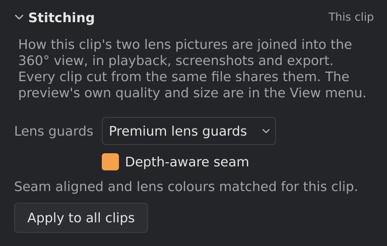
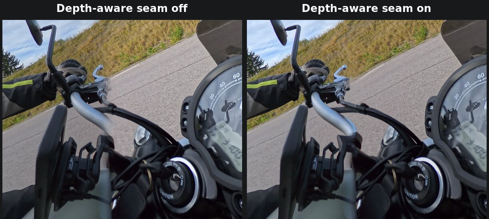

# Stitching

A 360° camera such as the X5 films with two fisheye lenses, back to back. Each one sees a little
more than half of the world. Stitching joins the two pictures into one
360° sphere. orbis-reframe does this itself, frame by frame, while it plays
and exports: there is no separate stitching step, and you don't need
Insta360 Studio.

The line where the two pictures meet is the **seam**. It runs all the way
round the camera, through both sides of it (left and right of the lenses),
over the top and under the bottom. Usually you won't see it. It can show
when something is very close to the camera, or when the settings below
don't match how the footage was filmed.

The settings are in the **Stitching** section, at the top of the settings
sidebar's **Video** tab. It starts folded: click its title to open it. Like
the other *This clip* sections, it shows the clip you've selected, or else
the clip under the playhead, and its settings apply to playback, screenshots
and the export alike.

The settings belong to the clip's **file**: every clip cut from the same
file (after a split, say) shares them, since one recording is filmed with
one set of lens guards. Clips from different files can differ, so a
project can mix footage filmed with and without guards.

## Lens guards

Set **Lens guards** to what was fitted over the lenses when you filmed:

- **None**: bare lenses.
- **Standard lens guards**
- **Premium lens guards**

Lens guards bend the light slightly, so each choice uses a different lens
model, recorded in the `.insv` file by the camera. The camera doesn't record
whether guards were fitted, so you have to tell orbis-reframe. With the
wrong choice the two pictures don't line up: things along the seam show up
twice, or have a piece missing.

The first clip in a project starts with **Premium lens guards**. A clip you
add later takes the settings of the nearest 360° clip beside it, or of the
other clips from its file if there are any. If you filmed without guards,
or with the standard ones, change this first; when the whole project was
filmed the same way, **Apply to all clips** gives every 360° clip the
settings shown.

Some cameras, the ONE X2 and the X6 among them, record no lens-guard
models. Their clips are always stitched with bare lenses: **Lens guards**
shows **None**, greyed out, with a line saying why. A clip from such a
camera comes in with **None** whatever the clip beside it has, and **Apply
to all clips** leaves its lens guards alone; applied from one of its clips,
it copies only **Stitcher** to the others. (A file that has only one
of the two guard models greys out the other choice.)

## Lens calibration

The camera records a model of its two lenses in every file, and orbis-reframe
stitches with it. That model is made at the factory, and on a real camera it
can be off by a few tenths of a degree: far-away things along the seam then
don't quite line up, and the picture as a whole sits slightly differently
from where Insta360 Studio puts it. **Calibrate lenses…** measures your own
camera's lenses with a chart on your monitor, so the two pictures line up
better than with the model in the file.

**Lens calibration** says which model a clip is stitched with:

- **From the camera file**: the model the camera recorded. Every clip starts
  with it unless you've calibrated its camera.
- **Calibrated** and a date: one you made with **Calibrate lenses…** for this
  camera and these lens guards. Hold the pointer over it to see how well it
  fitted.

A calibration belongs to one camera (it goes by the serial number in the
file) and one choice of **Lens guards**, since guards change how the lenses
draw the picture. Once you've calibrated a camera, clips from it that you add
to a project get the calibration for their lens guards by themselves.
Changing a clip's **Lens guards** switches to its camera's calibration for
the new guards, or to the camera file's if there is none. A clip set to
**From the camera file** stays with it until you pick a calibration. If you
calibrate again later, the newer one shows as *the camera's latest*:
projects keep the calibration their clips had until you pick the new one,
so finished projects don't change.

The project keeps a copy of the calibration each clip uses, so a project
opens the same on another computer. Projects with a calibrated clip can't be
opened by orbis-reframe versions before 0.8.

### Calibrating your camera

You need the camera, a monitor and about 20 minutes. Do it once for every
set of lens guards you film with (none, standard, premium). It needs no
project or clip: start it with **Calibrate lenses…** in the **Stitching**
section, or **Media ▸ Calibrate camera lenses…**, also from the project
library. It walks you through it:

1. **Show the chart.** Pick the monitor and click **Show the chart**: a
   chessboard with small patterns in its white squares fills the screen. A
   click or Esc closes it again. **Square size** is filled in from the size
   the monitor reports; measure one square with a ruler, and if it's
   different, put in what you measure (a tenth of a millimetre is plenty).
2. **Film it.** Fit the lens guards you want to calibrate for (or none), film
   in 8K, and hold the camera 50 cm to 1 m from the screen. Turn it slowly
   through five full circles, so the chart passes through every part of both
   lenses' pictures, right out to their edges: turning left to right; tilting
   forwards over the top; left to right again with the camera leaning 45°
   one way, then 45° the other way; and once round with the camera's sides
   (where the lenses meet) passing over the chart. Stop for a moment every
   few seconds: only the frames where the chart holds still are used. About
   three minutes is plenty.
3. **Measure it.** Choose the recording and the **Lens guards** it was
   filmed with, and click **Measure**. Finding the chart in every frame takes
   a few minutes, about twice as long as the recording.
4. **The result** says whether the calibration fits, how far out towards
   their edges both lenses saw the chart, how closely the chart's corners
   fit, and how much it moves the picture where the lenses meet compared
   with the camera file's model. **Save** keeps it for the camera and lens
   guards; with *Use it for this project's clips from this camera* ticked,
   the project's clips from that camera with those guards switch to it.

A recording that isn't good enough says why, and can't be saved:

- *The chart was still in too few frames*: turn more slowly and stop more
  often.
- *The front (or back) lens never saw the chart near the edge of its
  picture*: turn the camera further, so the chart passes the edge of each
  lens.
- *The chart's corners don't fit the lens model closely enough*: the square
  size is wrong, or the chart was blurred or had reflections on it.
- *The two lenses don't agree on where the chart is*: the camera was moving
  too fast.

Calibrating clears the clip's seam alignment and lens colour (below), which
are then measured again with the new model. **Calibrate lenses…** is
greyed out in builds made without OpenCV's chart detection.

## Stitcher

**Stitcher** picks how the two pictures are joined where they meet:

- **Depth-aware seam**: lines the two pictures up, frame by frame, at the
  distance of what is on the seam (see *Depth-aware seam* below).
- **Fixed seam**: lines the pictures up for things far away, the same in
  every frame. The seam holds still, but things close to the camera show up
  twice where the pictures meet.
- **New stitcher (experimental)**: the stitcher new clips start with, still
  being built; it will replace the other two. It joins the pictures from the lens model (the
  camera file's, or your calibration), and works out
  anything more from each frame and the ones just before it, not from the
  clip as a whole: the seam alignment and lens colour below aren't used with it. So
  far that is the colour where the lenses meet (*Seam colour blend* below)
  and close things crossing the seam (*Seam flow* below). For a camera whose
  files place one lens slightly off (the Antigravity A1, by about half a
  degree), it corrects the lenses by a fixed amount measured for the
  camera model; with your calibration it doesn't. Projects with a clip
  set to it can't be opened by orbis-reframe versions before 0.8.

A clip added to a project takes the stitcher of the 360 clip next to it, so
a project made before the new stitcher became the default keeps the
stitcher it was made with, for its new clips too; a project opened from
before then looks as it did. To move a whole project over, pick **New
stitcher (experimental)** on one clip and click **Apply to all clips**.

### Seam colour blend

With the new stitcher, **Seam colour blend** (under **Stitcher**, on for
new clips) evens out the two lenses' colours where they meet. It compares
what both lenses see in the overlap, closest to the seam, stretch by
stretch round it, over each frame and the quarter second before it, and
moves each lens half of the difference there: in full up to about 12°
from the seam, fading to nothing by 30°, so the rest of each picture
keeps the colour the lens recorded. A stretch where the lenses
can't be compared (a sky blown out in a colour, flare in one lens,
something close crossing the seam) takes the correction of the stretches
beside it; clipped highlights are left as they are. Going by a quarter
second keeps the correction steady while the picture moves, and still
follows a difference that changes with what the lenses see; when the light
changes, it follows within about a tenth of a second.

When the sun shines into one lens, light scattered inside it lays a haze
over that lens's picture (veiling light): the dark parts lift a lot, bright
ones hardly. No colour correction matches that, so where one lens has such
a haze along the seam, **Seam colour blend** takes it out of that lens
there, in the overlap and fading out by 10° past it, and matches the colour
of what is left. It goes by the frame and the one before it, since the haze
moves with the sun in the lens as the camera turns. Further into that lens
the haze stays (the other lens can't see there, so nothing says how much
there is). The rays and coloured blobs of flare are left as they are.

With **Seam colour blend** and **Seam flow** both on, the two pictures
meet in a narrow blend, about a degree and a half wide, right on the
seam. A wide blend would mix both lenses where each is at its softest,
near the edge of its picture, and blur the seam. Where the lenses still
show different pictures there -- the haze and the rays the sun puts into
one lens only, something close that the seam flow can't line up -- a
narrow blend would draw a line along the seam, so along that stretch the
blend widens to the whole overlap. It widens as soon as such a difference
appears and narrows again over a few frames, so it doesn't flicker. With
either setting off, the pictures are blended over the whole overlap.

When you jump to a frame, orbis-reframe looks at the quarter second before it as
it gets there, so a frame looks the same however you get to it: played,
jumped to, saved as a screenshot or exported. Turn it off to see the lenses as they recorded. With **Depth-aware seam**
and **Fixed seam** it is greyed out: they match the lenses their own way
(*Lens colour* below).

### Seam flow

Something close to the camera that crosses the seam -- the handlebars, a
mirror, your arm -- sits in a slightly different place in each lens, since
the two lenses are a few centimetres apart. With the new stitcher, **Seam
flow** (under **Seam colour blend**, on for new clips) joins it up. In
every frame it finds where each lens shows each part of the overlap round
the seam (optical flow, both ways), and draws the two pictures towards each
other: each lens moves by a share that grows from nothing 8° from the seam
to half the difference on the seam, so both show a close thing in the same
place there. Further than 8° from the seam each picture keeps its own
geometry, and far things, which the lenses already show in the same place,
don't move. Where the overlap is bright and has nothing to match -- sky
clipped to white, or the haze the sun lays over the scene, which each lens
draws in its own way -- the flow leaves the picture where it is, so the
seam beside the sun doesn't swim.

The flow is averaged over each frame and the four before it, so the seam
holds still while things pass through it; when you jump to a frame,
orbis-reframe measures those frames first, so the frame looks the same
however you get to it. A close thing that moves fast across the seam can
still smear for a frame or two. Turn it off to see the lenses joined at a
fixed distance, as with **Fixed seam**. It runs on the graphics card;
if orbis-reframe has to stitch on the processor instead, it needs a build
with OpenCV (the packages and AppImage have it) and is left out otherwise.

## Depth-aware seam

The two lenses sit a few centimetres apart, so they see things close to the
camera from slightly different places, just like your two eyes do. Far away
things line up at the seam, but close ones (the handlebars, the rider, the
stick) don't, and show up twice or broken where the lenses meet.

With **Stitcher** set to **Depth-aware seam**, orbis-reframe works out for every frame how
far away the things along the seam are, and lines the two pictures up at
that distance. It goes by the frames just before and after rather than one,
so the seam doesn't jump between a close object and the road behind it when
both match about equally well; something close that really moves onto the
seam is followed within a fraction of a second.

For that it analyses the parts of each clip you use, once, in the
background after the seam alignment and lens colour (below), the clip under
the playhead first, while playback is paused. From then on a frame is
stitched the same way however you get to it: played, stepped back to,
saved as a screenshot or exported. The analysis is kept in the project's
cache folder, so it isn't done again next time, and isn't saved in the
project file. Until a clip is analysed, its seam is worked out as it plays,
from the frames played so far; a frame you jump to can then look a little
different from the same frame played into. An export analyses what it
still needs first, which shows as *Analysing the seam* in its progress. On a
computer that decodes the video without the graphics card, clips aren't
analysed in the background (it would take too long) -- only an export's or
a screenshot's own frames are. It matches the lenses by the
detail they see, not by how bright they are, so glare from a low sun on
the seam, which each lens draws differently, isn't taken for something
close. Where the match can't tell the distance -- a smooth stretch of sky,
or a fence or grille whose pattern repeats -- the seam doesn't guess: it
takes the distance from the stretches beside it, or keeps it far away. On a
camera whose lenses sit further apart (the Antigravity A1) it lines up
nothing closer than about 70 cm.

Things at different distances side by side (a rack in front of the bike's
tail, a mirror stem in front of the road) can't all line up at one
distance. So the seam also looks for the line across the overlap where the
two lenses agree best, and joins them there with a short blend, instead of
fading one into the other over the whole overlap.

A short blend would show any difference in brightness or colour between
the two lenses as a step; how they are matched is under *Lens colour*
below.

Very close things that the two lenses see against different backgrounds
(a crash bar and a cable right under the camera) can still look doubled in
places: no single distance lines everything up there, and there's no line
the lenses agree on either. There the seam keeps the long fade, which
shows them softly doubled rather than broken.

*The handlebar crosses the seam. Off, the bar is broken and the brake cable
shows twice; on, they join up.*

Where nothing is close to the camera, as on drone footage, it has nothing
to line up, and the picture just round the seam can seem to move or bend
slightly while playing: pick **Fixed seam** there, or the new stitcher.

## Seam alignment

A camera's two lenses are never mounted quite perfectly, and the lens model
in the file doesn't capture every small difference: on far-away things the
two pictures can disagree by a few tenths of a degree, which shows as fine
detail (branches, wires, window frames) slightly doubled along the seam.
With **Depth-aware seam** or **Fixed seam**, orbis-reframe measures how
the two lenses line up from the video itself, once for each clip, and
corrects the lens model by that: how the back lens
is turned, where its centre is, and how large both lenses draw the picture
near the seam. Things close to the camera don't line up by this alone; see
*Depth-aware seam* above. Like the gyro sync (see
[Stabilization](stabilization.md)), this runs in the background while
playback is paused, and the result is saved in the project.

The **Stitching** section shows, in one line, how far this, the lens colour
measurement (see *Lens colour* below) and the depth-aware seam's analysis
have got for the clip under the playhead:

| Message | Meaning |
|---|---|
| *Measuring this clip's seam…* | The seam alignment is running. The lens colour is measured after it. |
| *Seam aligned; measuring this clip's lens colours…* | The seam is done, the lens colour is running. |
| *Seam aligned and lens colours matched for this clip.* | Both done. |
| *Analysing this clip's seam… N %* | After both: the depth-aware seam's analysis (see *Depth-aware seam* above) is running. It stops while playing and goes on from where it was. |
| *The new stitcher measures nothing from this clip.* | **Stitcher** is set to **New stitcher (experimental)**, which needs none of these: it joins the lenses from their lens model, and its **Seam colour blend** goes by the frames as they're shown. |
| *Couldn't align this clip's seam (…)* | The seam alignment didn't succeed; the brackets say why (below). The clip is stitched with the camera's lens model only, and its lens colour is still measured. |
| *… couldn't match the lens colours (…)* | The lens colour measurement didn't succeed, for one of the same reasons. The lenses are stitched as recorded. |

Hold the pointer over the line to see what was measured. For the seam: how
far the back lens is turned to line up with the front one (yaw, pitch and
roll, in degrees), how far its picture's centre moves (in percent of the
picture's width), and how much larger (or, negative, smaller) both lenses
draw the picture near the seam (the lens scale, in percent). A fraction of a
degree, and a few hundredths of a percent, are normal. For the lens colour:
how far apart the two lenses were on the seam, per colour, in percent; a few
percent is normal.

The reasons a measurement gives:

- *the file can't be read*: the file is damaged or not a video. The
  technical details are in the log.
- *not a 360 camera file*: the file is a video, but not one from a 360
  camera orbis-reframe knows.
- *this kind of 360 clip isn't supported*: the camera's file, in a mode
  orbis-reframe can't stitch.
- *too little detail along the seam*: the picture where the two lenses meet
  is too plain (sky, a wall, darkness) to line them up by.

Changing **Lens guards** or **Lens calibration** measures the clip's file
again, because the alignment depends on the lens model. Projects from orbis-reframe 0.5 and
older measured only how the back lens is turned; their clips are measured
again when the project opens.

## Lens colour

The two lenses of a camera never record quite the same colour: one is a
little warmer or brighter than the other, and towards their rims they fall
off differently, in colour too. Left alone, that would show as a step along
the seam. With **Depth-aware seam** or **Fixed seam**, orbis-reframe measures
how the two lenses of a clip differ, colour by colour, from frames spread across the clip, once for each clip, right
after the seam alignment; frames with flare from a low sun, and very dark
parts of the picture, are left out, and so is a colour where it is clipped
(a bright sky's blue), while the other colours there still count. Each lens
is then brought half
way towards the other over its whole picture, so the seam has no step and
neither lens is changed more than needed. The result is saved in the
project.

On most cameras the difference stays the same through a clip. Where it
drifts (the ONE X2's lenses do), a small, slow correction from the frames
being played follows it. And it isn't always the same all the way round the
seam: with a low sun, one lens catches veiling light on the sun's side, and
on some clips the lenses agree on one stretch of the seam and differ on the
rest. So along the seam the two lenses are also matched stretch by stretch,
frame by frame, from what both see right where they meet (the difference
can depend on what is there: the lenses may agree on the sky and not on the
shadowed trees below it); a stretch where they see nothing alike to compare
(a sky blown out in every colour, very close things) is left alone, and
doesn't take its neighbours' correction either. This correction only
touches the overlap and fades out just past it, and follows the picture
within a frame or two as the camera turns.

When the sun shines into one lens, light scattered inside that lens lays a
haze over its picture (veiling light): the dark parts lift a lot, bright
ones hardly. A colour correction can't match that, so where one lens has
such a haze along the seam, the haze is taken out of that lens there, and
the two lenses are blended over the whole overlap rather than meeting on a
line. Further into that lens the haze stays (the other lens can't see
there, so nothing says how much there is): it fades out towards the seam
instead of stopping at it. The rays and coloured blobs of flare (reflections
inside the lens) are left as they are. The stretch-by-stretch match and the
haze need **Stitcher** set to **Depth-aware seam**; the new stitcher's
**Seam colour blend** does both its own way (above).

Bright highlights are left as recorded: a sky that is blown out in both
lenses stays the same white on both sides of the seam rather than turning
slightly grey on one.

The **Stitching** section's line shows when it's done (see *Seam alignment*
above).

Like the seam alignment, changing **Lens guards** or **Lens calibration**
measures the clip's file again. Projects from older versions of orbis-reframe matched the lenses
frame by frame, or measured the lens colour without the colours a clipped
part still has; their clips are measured again when the project opens, so
their colour along the seam changes slightly.

## Preview size

**View ▸ Preview size** is in the **View** menu, not in the sidebar: it
changes only the preview you see while editing, never the export, and it
almost never matters. The viewport normally draws straight from the two
lens pictures at full detail. Only when the graphics card or driver can't
do that does orbis-reframe stitch a flat 360° preview first, and this sets
its size. **Auto** uses the clip's full detail, as much as can play
smoothly at its frame rate.

## Filming tips

- **Keep important things off the seam.** Point one lens at what matters
  most (the road ahead, the person you're filming). The seam then runs
  through the camera's sides, where close objects are least likely to be.
- **Keep close things away from the camera's sides.** A hand, a handlebar
  or a wall near the side of the camera crosses the seam. The new
  stitcher's seam flow and the depth-aware seam help, but the further away,
  the cleaner the join.
- **A selfie stick straight below the camera mostly disappears**: it falls
  in the narrow gap between what the two lenses see. Keep the stick in line
  with the camera body so it stays in that gap.
