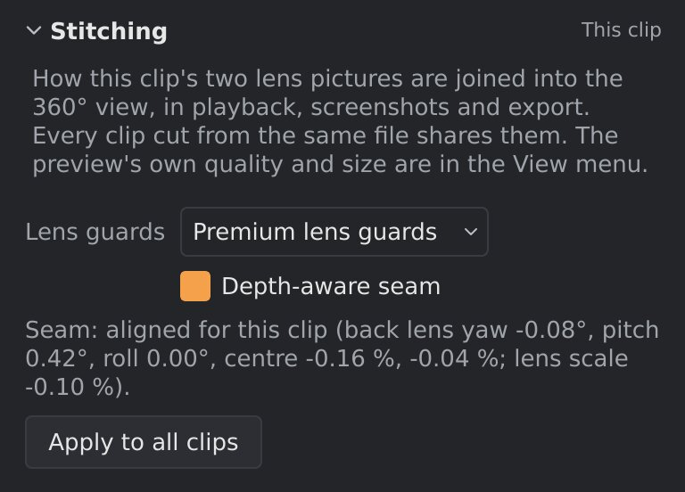
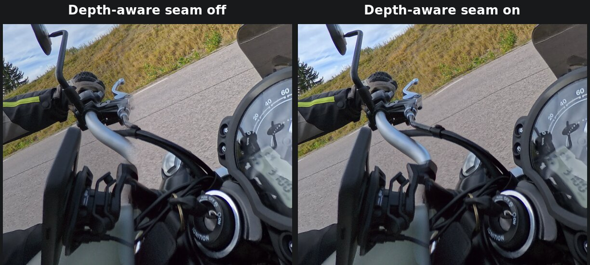

# Stitching

A 360° camera such as the X5 films with two fisheye lenses, back to back. Each one sees a little
more than half of the world. Stitching joins the two pictures into one
360° sphere. orbis-reframe does this itself, frame by frame, while it plays
and exports: there is no separate stitching step, and you don't need
Insta360 Studio.

The line where the two pictures meet is the **seam**. It runs all the way
round the camera, through both sides of it (left and right of the lenses),
over the top and under the bottom. Usually you won't see it. It can show
when something is very close to the camera, or when the settings below
don't match how the footage was filmed.

The settings are in the **Stitching** section, at the top of the settings
sidebar's **Video** tab. It starts folded: click its title to open it. Like
the other *This clip* sections, it shows the clip you've selected, or else
the clip under the playhead, and its settings apply to playback, screenshots
and the export alike.

The settings belong to the clip's **file**: every clip cut from the same
file (after a split, say) shares them, since one recording is filmed with
one set of lens guards. Clips from different files can differ, so a
project can mix footage filmed with and without guards.

## Lens guards

Set **Lens guards** to what was fitted over the lenses when you filmed:

- **None**: bare lenses.
- **Standard lens guards**
- **Premium lens guards**

Lens guards bend the light slightly, so each choice uses a different lens
model, recorded in the `.insv` file by the camera. The camera doesn't record
whether guards were fitted, so you have to tell orbis-reframe. With the
wrong choice the two pictures don't line up: things along the seam show up
twice, or have a piece missing.

The first clip in a project starts with **Premium lens guards**. A clip you
add later takes the settings of the nearest 360° clip beside it, or of the
other clips from its file if there are any. If you filmed without guards,
or with the standard ones, change this first; when the whole project was
filmed the same way, **Apply to all clips** gives every 360° clip the
settings shown.

Some cameras, the ONE X2 and the X6 among them, record no lens-guard
models. Their clips are always stitched with bare lenses: **Lens guards**
shows **None**, greyed out, with a line saying why. A clip from such a
camera comes in with **None** whatever the clip beside it has, and **Apply
to all clips** leaves its lens guards alone; applied from one of its clips,
it copies only **Depth-aware seam** to the others. (A file that has only one
of the two guard models greys out the other choice.)

## Depth-aware seam

The two lenses sit a few centimetres apart, so they see things close to the
camera from slightly different places, just like your two eyes do. Far away
things line up at the seam, but close ones (the handlebars, the rider, the
stick) don't, and show up twice or broken where the lenses meet.

With **Depth-aware seam** on, orbis-reframe works out for every frame how
far away the things along the seam are, and lines the two pictures up at
that distance. It goes by the last few frames rather than one, so the seam
doesn't jump between a close object and the road behind it when both match
about equally well; something close that really moves onto the seam is
followed within a fraction of a second.

Very close things that the two lenses see against different backgrounds
(a crash bar and a cable right under the camera) can still look doubled in
places: no single distance lines everything up there.

*The handlebar crosses the seam. Off, the bar is broken and the brake cable
shows twice; on, they join up.*

It's on in new projects, and there's rarely a reason to turn it off.

## Seam alignment

A camera's two lenses are never mounted quite perfectly, and the lens model
in the file doesn't capture every small difference: on far-away things the
two pictures can disagree by a few tenths of a degree, which shows as fine
detail (branches, wires, window frames) slightly doubled along the seam.
orbis-reframe measures how the two lenses line up from the video itself,
once for each clip, and corrects the lens model by that: how the back lens
is turned, where its centre is, and how large both lenses draw the picture
near the seam. Things close to the camera don't line up by this alone; see
*Depth-aware seam* above. Like the gyro sync (see
[Stabilization](stabilization.md)), this runs in the background while
playback is paused, and the result is saved in the project.

The **Stitching** section shows the state for the clip under the playhead:

| Message | Meaning |
|---|---|
| *Seam: measuring this clip…* | The measurement is running. |
| *Seam: aligned for this clip (back lens yaw …, pitch …, roll …, centre …, …; lens scale …).* | Done. Yaw, pitch and roll are how far the back lens is turned to line up with the front one, in degrees; the centre is how far its picture's centre moves, in percent of the picture's width; the lens scale is how much larger (or, negative, smaller) both lenses draw the picture near the seam, in percent. A fraction of a degree, and a few hundredths of a percent, are normal. |
| *Seam: couldn't align this clip (…).* | The measurement didn't succeed; the brackets say why (below). The clip is stitched with the camera's lens model only. |

The reasons a measurement gives:

- *the file can't be read*: the file is damaged or not a video. The
  technical details are in the log.
- *not a 360 camera file*: the file is a video, but not one from a 360
  camera orbis-reframe knows.
- *this kind of 360 clip isn't supported*: the camera's file, in a mode
  orbis-reframe can't stitch.
- *too little detail along the seam*: the picture where the two lenses meet
  is too plain (sky, a wall, darkness) to line them up by.

Changing **Lens guards** measures the clip's file again, because the
alignment depends on the lens model. Projects from orbis-reframe 0.5 and
older measured only how the back lens is turned; their clips are measured
again when the project opens.

## Preview size and quality

These two are in the **View** menu, not in the sidebar: they change only the
preview you see while editing, never the export.

- **View ▸ Preview size** almost never matters. The viewport normally draws
  straight from the two lens pictures at full detail. Only when the graphics
  card or driver can't do that does orbis-reframe stitch a flat 360° preview
  first, and this sets its size. **Auto** uses the clip's full detail, as
  much as can play smoothly at its frame rate.
- **View ▸ Preview quality** has only one choice for now, **Standard**. **Optical flow**,
  a smoother seam for close objects, isn't available yet.

## Filming tips

- **Keep important things off the seam.** Point one lens at what matters
  most (the road ahead, the person you're filming). The seam then runs
  through the camera's sides, where close objects are least likely to be.
- **Keep close things away from the camera's sides.** A hand, a handlebar
  or a wall near the side of the camera crosses the seam. Depth-aware seam
  helps, but the further away, the cleaner the join.
- **A selfie stick straight below the camera mostly disappears**: it falls
  in the narrow gap between what the two lenses see. Keep the stick in line
  with the camera body so it stays in that gap.
