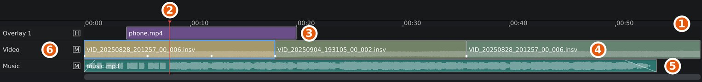
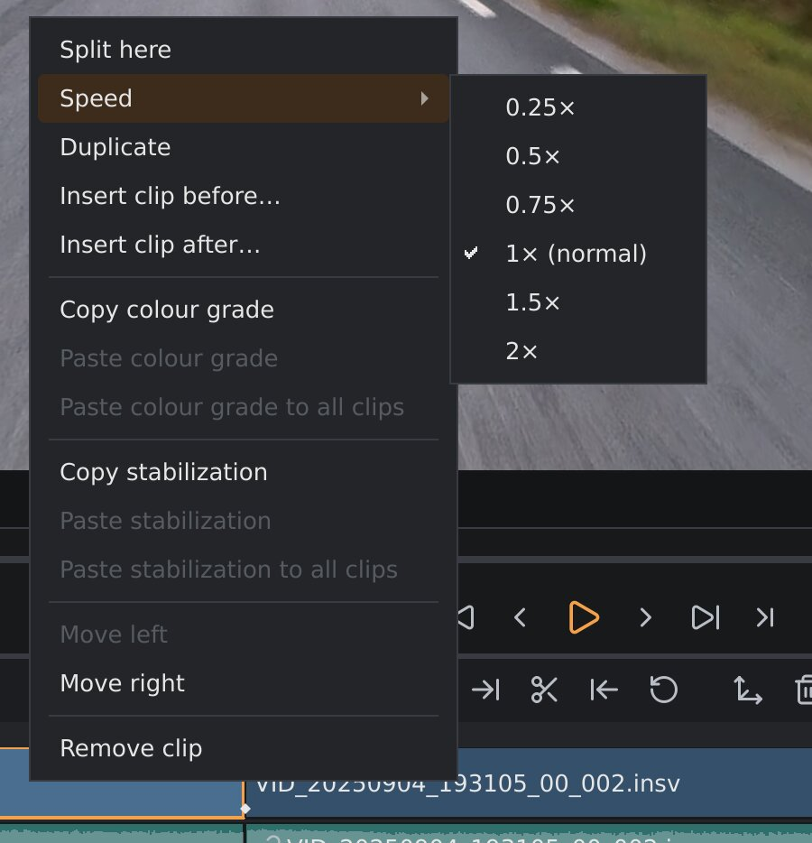

# The timeline

The timeline is your edit: which clips play, in which order, and what
plays alongside them. This page covers moving around in it, arranging and
cutting the 360° clips, and adding music, other sound and picture-in-picture
overlays. For the names of the window's parts, see
[The main window](main-window.md).

1. The **ruler**, with the time in minutes and seconds.
2. The **playhead**: the frame shown in the viewport.
3. An **overlay track**, with a picture-in-picture clip.
4. The **video track**, with your `.insv` clips. The white diamonds along
   the bottom edge are reframe keyframes; a hollow diamond (◇) before a
   clip's name means it has none, and exports looking straight ahead.
5. An **audio track**, with a music file. The waveform shows how loud it
   is, and the slanted lines at its ends are fades.
6. The **track headers**: each track's name and its **M** (mute) or **H**
   (hide) box.

The video track sets the length of your video: the export runs from the
start of the first clip to the end of the last. Audio and overlay clips that
reach past that end are cut off.

## Moving around

Only the ruler moves the playhead. Click on it to jump to a frame, or drag
along it to scrub through the video. Clicking a clip selects it but leaves
the playhead where it is.

| Key | Moves the playhead |
|---|---|
| `Space` | Play / pause. |
| `←` / `→` | One frame back / forward (pauses playback). |
| `Shift+←` / `Shift+→` | One second back / forward. |
| `↑` / `↓` | To the previous / next cut or clip edge. |
| `Home` / `End` | To the start / end of the timeline. |

**Zooming.** Hold `Ctrl` and turn the mouse wheel over the timeline to zoom
in or out around the pointer. `Ctrl++` and `Ctrl+-` zoom around the
playhead, and `Ctrl+0` fits the whole edit in the window again. The same
commands are in the menu you get by right-clicking an empty part of a track.

While zoomed in, turn the mouse wheel (without `Ctrl`) or drag the scroll
bar under the tracks to move along the timeline. When the playhead runs
off the edge, for example during playback, the view follows it.

## The video track

The video track holds your `.insv` clips, one after another, with a hard cut
from each clip to the next. There are never gaps between them: when you
shorten or remove a clip, the clips after it move up.

Right-click a clip for its menu: split it, change its speed, insert
another clip before or after it, copy or paste its colour grade
([Colour](colour.md)) or its stabilization
([Stabilization](stabilization.md)), move it, or remove it.

### Adding clips

- **Media ▸ Add clip to timeline…** (`Ctrl+Shift+A`) adds a clip at the end.
- Right-click a clip and choose **Insert clip before…** or **Insert clip
  after…** to put the new clip next to it.
- Right-click an empty part of the video track (or of an empty timeline)
  and choose **Add clip here…**. The clip goes in at the nearest cut.
- Drag clips from the **Media** tab on the left
  ([The main window](main-window.md#the-media-sidebar)) onto the timeline;
  double-clicking one there adds it at the end.
- Drag `.insv` files from your file manager onto the timeline panel (not
  the viewport). They go in at the cut nearest to where you drop them, in
  the order the file manager gives them; on an empty timeline the first one
  starts the video track. Drop the `.insv` master, not the `.lrv` proxy.

You can add the same `.insv` file more than once, for example to use two
different parts of a long recording.

### Selecting a clip

Click a clip to select it. The settings sidebar's sections (stabilization,
colour, audio and so on) now change this clip, even when the playhead is
somewhere else. Press `Esc` to clear the selection. The sections then follow
the clip under the playhead again. The clip they're changing always has an
orange outline.

### Reordering

Drag a clip to another place on the video track. You can also right-click
it and choose **Move left** or **Move right**.

### Trimming

Trimming cuts frames off the start or end of a clip. Nothing is deleted
from the file: you can always get the frames back.

- Drag the left or right edge of a clip.
- Or move the playhead to the frame you want, and press `[` to make the
  clip start there or `]` to make it end there. The two buttons in the
  transport bar do the same.
- The **Restore** button in the transport bar (`R`) gives the clip its full
  length back.

`[`, `]` and **Restore** work on the selected clip, or on the clip under the
playhead if none is selected. With a selected clip, the playhead has to be
inside that clip.

### Splitting

Splitting cuts a clip in two at the playhead, so you can remove the middle
of a recording, or give each part its own settings.

- Move the playhead to the frame where the cut should be and press `S`.
- Or right-click the clip where you want the cut and choose **Split here**.

Both halves keep everything the clip had: its stabilization, colour,
audio settings and reframe keyframes.

### Speed: slow motion and fast forward

Right-click a clip and choose a speed under **Speed**: 0.25×, 0.5×, 0.75×,
1× (normal), 1.5× or 2×. The clip gets longer or shorter on the timeline to
match. Its sound is sped up or slowed down without changing its pitch.

Slow motion looks smoothest with footage shot at a high frame rate: a clip
recorded at 120 fps, played at 0.25×, shows every frame it recorded in a
30 fps export.

### Removing

Select the clip and press `Delete` (or `Backspace`), or right-click it and
choose **Remove clip**. Its linked audio (see below) is removed with it.

### The camera's sound

The video clips play the sound the camera recorded. Click the **M** box in
the **Video** track header to mute the camera's sound for all clips, for
example when your video should only have music. The **Audio** tab sets the
volume, picks the microphone and reduces noise and wind for each clip: see
[Audio and noise reduction](audio.md).

## Audio and overlay tracks

Besides the video track, you can add any number of other tracks:

- **Audio tracks**, under the video track: music, sound from an external
  recorder, or a second microphone. Files: `.mp3`, `.wav`, `.flac`, `.aac`,
  `.m4a`, `.ogg` and `.opus`.
- **Overlay tracks**, above the video track: ordinary flat videos shown as a
  picture-in-picture over the 360° video, for example from a phone or an
  action camera. Files: `.mp4`, `.mov`, `.mkv`, `.m4v`, `.webm` and `.avi`.
  How to place and size them is in [Overlays](overlays.md).

Unlike the video track, these tracks can have gaps: each clip sits at its
own time.

You need at least one clip on the video track before you can add audio or
overlays.

### Adding audio and overlays

There are four ways:

- **Media ▸ Add audio file…** (`Ctrl+Shift+M`) or **Media ▸ Add video
  overlay…** (`Ctrl+Shift+V`). The file goes in at the playhead.
- Drag files from the **Media** tab onto the timeline, the same way as from
  a file manager (below), or double-click one there to put it in at the
  playhead.
- Right-click on the timeline where the clip should start and choose **Add
  audio file here…** or **Add video overlay here…**.
- Drag audio files or flat videos from your file manager onto the timeline
  panel (not the viewport). They go in where you drop them: on the track you
  drop them on, or, if you drop them somewhere else on the timeline, on the
  first track with room for them. Dropped together with `.insv` clips, they
  start where the clips go in. Without a clip on the video track, only
  `.insv` clips can be dropped.

If there's no track of the right kind with room, orbis-reframe makes a new
one. To make an empty track yourself, choose **Media ▸ Add audio track** or
**Media ▸ Add overlay track**, or right-click the timeline and choose one of
them.

### Editing clips on these tracks

| To | Do |
|---|---|
| Select a clip | Click it. |
| Move it in time | Drag it left or right. It snaps to the playhead, the cuts on the video track and the edges of other clips. |
| Move it to another track | Drag it up or down onto another track of the same kind. |
| Trim it | Drag its left or right edge, or select it and use `[` and `]` as on the video track. |
| Split it | Select it and press `S`, or right-click it and choose **Split here**. |
| Remove it | Select it and press `Delete`, or right-click it and choose **Remove audio clip** / **Remove overlay clip**. |
| Change its volume or fade it in and out | Select it and use the settings sidebar's **Audio** tab. |
| Change an overlay's size, position or look | Select it and use the settings sidebar's **Overlay** tab. |

`S`, `[`, `]` and `Delete` act on the selected audio or overlay clip if
there is one, and on the video track otherwise.

### Managing tracks

| To | Do |
|---|---|
| Mute an audio track | Click the **M** box in its header. Click it again to hear it. |
| Hide an overlay track | Click the **H** box in its header. |
| Rename a track | Double-click its name, type the new name and press `Enter` (`Esc` cancels). Or right-click it and choose **Rename track…**. |
| Change the order of tracks | Drag a track header up or down, or right-click the track and choose **Move track up** / **Move track down**. Overlay tracks stay above the video track and audio tracks below it. A higher overlay track is drawn on top of a lower one. |
| Remove a track and everything on it | Right-click the track and choose **Remove track**. |

## Linked audio

An audio clip can be **linked** to a clip on the video track or on an
overlay track. A linked clip keeps in step with that clip: when you move,
trim, split or speed up the video, its linked audio does the same, and when
you remove the video clip, the linked audio goes with it. Linked clips show
a chain icon before their name. You can still move a linked clip to another
audio track, but not to another time.

You get linked audio in two ways:

- **A second microphone.** If you recorded with an external microphone
  connected to the camera (such as the Insta360 Mic Air), the `.insv` file
  holds two sound recordings. Right-click the clip and choose **Put the
  other mic on an audio track**. The second recording goes onto an audio
  track called *Mics*, linked to the clip. You can then set the volume of
  each microphone on its own, or mute one.
- **An overlay's sound.** If an overlay video has sound, right-click it and
  choose **Put its sound on an audio track**.

To link or unlink an audio clip yourself, right-click it and choose **Link
to video clip** or **Unlink from video clip**. **Link** is only offered when
a video clip shows the same recording, for example after you've unlinked
the clip. Linking keeps the audio where it is. To shift a clip's sound
against its picture, unlink it, move it, and link it again.

Audio and overlay clips that aren't linked stay at their time when you edit
the video track. If you shorten or remove a video clip, check that your
music and overlays still line up.
