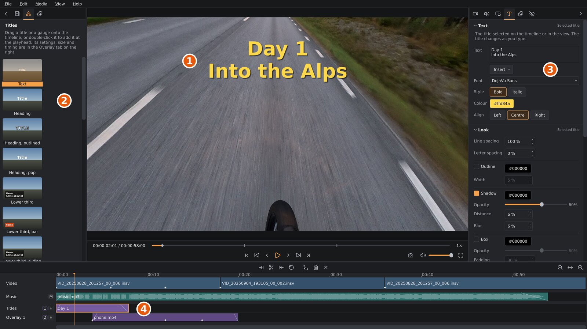
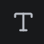

# Titles

A title is text shown over your video: the name of the ride, a place, a
date. Titles sit on overlay tracks, like picture-in-picture videos
([Overlays](overlays.md)), and are placed, keyframed and faded the same way.
They can also slide in and out, pop up, or type themselves on letter by
letter, and show the time of day the video was recorded, running as it
plays.

1. The title in the viewport. Drag it to move it.
2. The media sidebar's **Titles** tab.
3. The settings sidebar's **Title** tab, with the selected title's
   text, font, colour and alignment, then how its text is drawn (outline,
   shadow, box, spacing), and below them how it comes and goes, and its
   position, size and timing.
4. The title on its overlay track.

## Adding a title

Open the media sidebar's **Titles** tab
(). Its tiles are
ready-made titles, each showing roughly how and where it lands in the
picture. An animated one plays its animation while the mouse is over it:

| Tile | What you get |
|---|---|
| **Text** | *Title* in white bold letters in the middle of the picture. |
| **Heading** | A big title in the middle, with a soft shadow. |
| **Heading, outlined** | A big title in spaced-out capitals with a black outline, readable over a bright sky or snow. |
| **Heading, pop** | The heading, popping up at the start and shrinking away at the end. |
| **Lower third** | Two lines in the lower left on a dark box: a name, and a line about it. |
| **Lower third, bar** | One line in the lower left on a solid coloured bar. |
| **Lower third, sliding** | The lower third, sliding in from the left and back out at the end. |
| **Caption** | Small text at the bottom in the middle, on a rounded box. |
| **Caption, typed** | The caption, typing itself on at the start and off again at the end. |
| **Date** | The date in the lower right. |
| **Clock** | The time of day in the lower right, running as the clip plays. |
| **Date and place** | The date and, below it, *Place* to type over, in the lower left. |

To add one:

- drag its tile onto the timeline, onto an overlay track or anywhere under
  the tracks; or
- double-click the tile (or select it and press `Enter`, or right-click it
  and choose **Add to timeline**) to add it at the playhead.

The new title lasts 5 seconds. It goes onto the overlay track you dropped
it on if that track is free there; otherwise onto the first overlay track
that is, or a new one. The title is selected and the settings sidebar shows
its **Title** tab (),
ready to type the text. There must be a clip on the video track first.

The **Date** tiles show the day the clip under the title was recorded, as
your computer writes a date in full (in US English, *Thursday, August 28,
2025*), and the **Clock** tile the time of day, running as the video
plays. Both come from the camera's clock, as the clip's file records it,
and follow the video: after a cut to a clip recorded on another day, the
date changes with it. In the text they are fields, `{date}` and `{time}`;
see [The recording time as a clock](#the-recording-time-as-a-clock).
orbis-reframe doesn't look up places: type the place yourself.

A tile is only where a title starts. Once added it is an ordinary title:
everything below can be changed, and nothing ties it to its tile.

## Text, font, colour and alignment

Select the title on the timeline, or click it in the viewport. The settings
sidebar's **Title** tab then shows its settings, in four sections. If the
**Overlay** tab is showing, it switches to the **Title** tab by itself (and
back again when you select an overlay video). The **Text** section:

| Setting | What it does |
|---|---|
| **Text** | The title's text. `Enter` starts a new line. The title changes as you type. |
| **Insert** | Puts the recording time or date into the text where the cursor is: **Time**, **Time with seconds** or **Date**. See [The recording time as a clock](#the-recording-time-as-a-clock). |
| **Clock** | Shown while the text has a time in it: how it writes the hours. **As the system writes it**, **24-hour** or **12-hour (AM / PM)**. |
| **Font** | The typeface, picked from a list of every font installed on your computer, each shown in its own face. The three fonts you picked last are at the top. Type a name's first letters to jump to it. A project made on another computer may use a font that isn't installed here: it is listed as *(not installed)*, kept, and drawn with a similar font until you pick another. |
| **Style** | **Bold** and **Italic**; click to switch them on or off. |
| **Colour** | Click to choose the text's colour. |
| **Align** | **Left**, **Centre** or **Right**: how the lines line up under each other, and which point of the title its position is. A left-aligned title's position is its left edge, so the text keeps its start where you put it as you type more, as a caption in a corner should; a right-aligned one keeps its right edge. Changing the alignment doesn't move the text. |

On the timeline, a title is labelled with its first line.

## The recording time as a clock

A title can show when the video under it was recorded: the time of day, or
the date, from the camera's clock as the clip's file records it. It is a
*field* in the title's text, which the **Insert** button below the text puts
in where the cursor is, or which you type:

| Field | Shows | Example (US English) |
|---|---|---|
| `{time}` | The time, hours and minutes | *2:56 PM* |
| `{time:ss}` | The time with seconds | *2:56:48 PM* |
| `{date}` | The date, written in full | *Saturday, September 27, 2025* |

The text box shows the field; the picture shows its value. A field can sit
among other text (*Leaving camp at {time}*), and a title can have several.
To show a brace itself, type it twice: `{{` shows as `{`.

The value follows the video. At every moment it is the recording time of
the clip on the video track under the title at that moment, so it keeps
running as the clip plays; a trim starts it later, a clip at double speed
makes it run twice as fast, and after a cut it jumps to the next clip's
time. The time is written as your computer writes it -- 24 hours or AM /
PM, as the system's language and region settings say -- unless the
**Clock** setting below the text picks **24-hour** or **12-hour (AM /
PM)**. The language setting decides, not a desktop clock's own format: a
system set to US English writes 2:56 PM even if the clock in your panel
shows 14:56. A title set to 24 or 12 hours looks the same when the project
is exported on another computer. The digits are all drawn
as wide as each other, so a centred or right-aligned clock doesn't shift as
it ticks.

The camera writes the recording's start to the second, not the fraction of
a second the first frame began at, so the clock can be up to a second
behind the real time.

Where the clip under the title doesn't say when it was recorded (a phone
or action-cam video: the recording time is read only from the 360 cameras
orbis-reframe knows), the time
shows `--:--` (`--:--:--` with seconds) and the date nothing. The **Text**
section then says which clips those are.

## Outline, shadow, box and spacing

The **Look** section draws more than the letters, to keep a title readable
over a bright sky or a busy road. Sizes are a percentage of the text size,
so the look stays the same when you make the title bigger or smaller.

| Setting | What it does |
|---|---|
| **Line spacing** | The space from one line to the next: 100 % is the font's own, more spreads the lines apart. |
| **Letter spacing** | Space added between the letters; below 0 brings them closer. |
| **Outline** | A line round each letter, in the colour on the button beside it (click it to choose). **Width**: how thick. |
| **Shadow** | A soft shadow below and to the right of the text (and of its outline), in its colour. **Opacity**; **Distance**: how far it falls from the text; **Blur**: how soft its edge is, 0 % for a sharp one. |
| **Box** | A filled box behind the text, in its colour. **Opacity**; **Padding**: the room between the text and the box's edge; **Corners**: how round its corners are, 50 % for round ends. |

Each can be switched on and off with its tick box; switched off, it keeps
its settings for when you switch it on again. With a box, a left- or
right-aligned title's position is the box's edge.

## Sliding, popping and typing in and out

The **Animation** section sets how the title comes on at its start and
goes off at its end:

| Setting | What it does |
|---|---|
| **In** | **Slide in from the left**, **right**, **top** or **bottom**: the title starts just outside that edge of the picture and slides to its place, slowing down as it arrives. **Pop up**: it grows from nothing, a little past its full size, and settles. **Type on**: its text appears letter by letter, evenly over the length. **None**: it is simply there. |
| **Length** | How long coming on takes, in seconds. |
| **Out** | The same backwards: **Slide out to the left**, **right**, **top** or **bottom**, speeding up as it leaves, **Shrink away**, or **Type off**, taking the letters away from the end. |
| **Length** | How long going off takes. |

The animation is tied to the title's start and end, so it stays right when
you make the title longer, shorter or move it. It adds to everything else:
a title with keyframes slides in to where its keys put it, and a fade in
fades it in as it slides. If the title is shorter than both lengths
together, each takes its share of the title's time.

While a title types on, the letters already typed stay where they are in
the finished text, and a line being typed grows from the side its **Align**
names: from the left edge, out from the middle, or leftwards from the right
edge. Spaces and line breaks count as letters. A box behind the text is
there at its full size from the start, and the outline and shadow come
with each letter.

Splitting a title keeps its **In** on the first part and its **Out** on the
second.

## Position, size, keyframes and fades

The Title tab's **Position and timing** section. These work as for an
overlay video ([Overlays](overlays.md)):

- **Position X** and **Position Y**: where the title is, as a percentage
  of the picture's width and height: across, its left edge, middle or right
  edge, as its **Align** says; down, its middle. Or drag the title in the
  viewport; dragging it while it slides moves where it slides to.
- **Text size**: how tall the letters are, as a percentage of the picture's
  height. 8 % is a good size for a heading; the box around the text grows
  with the text, so typing more doesn't make the letters smaller.
- **Opacity**: 100 % is solid.
- **Keyframes**: with **Set key** (`K`) a title can move, grow, shrink or
  fade during its clip, exactly like an overlay video
  ([Moving an overlay during a clip](overlays.md#moving-an-overlay-during-a-clip)).
  Its text and how it's drawn stay the same for the whole clip.
- **Fade in** / **Fade out** and **Start**: as for an overlay.
- **Duration**: how long the title shows, in seconds. Its start stays put
  and its end moves.

A title has no corners or border settings, and no sound.

To make a title longer or shorter, set its **Duration**, or drag its ends
on the timeline. Trimming,
splitting, moving it to another overlay track, hiding its track and the
layer order all work as for an overlay clip ([The timeline](timeline.md#audio-and-overlay-tracks),
[Several overlays](overlays.md#several-overlays)).

Titles appear in playback, screenshots and the export exactly as in the
viewport. The text is drawn at the export's resolution, so it stays sharp
in a 4K export.
